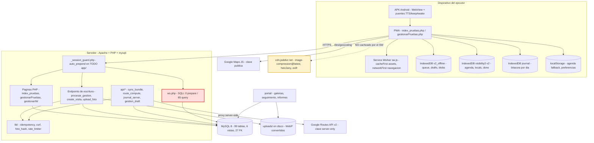
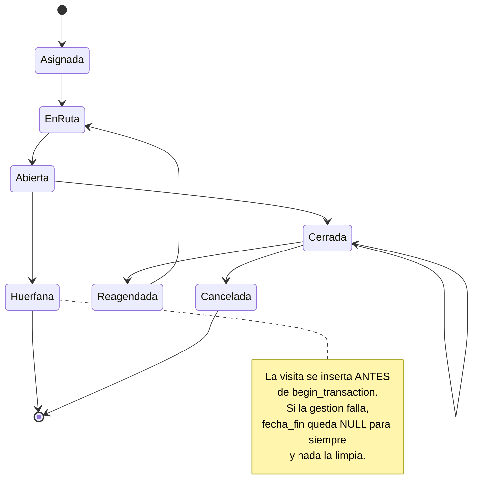
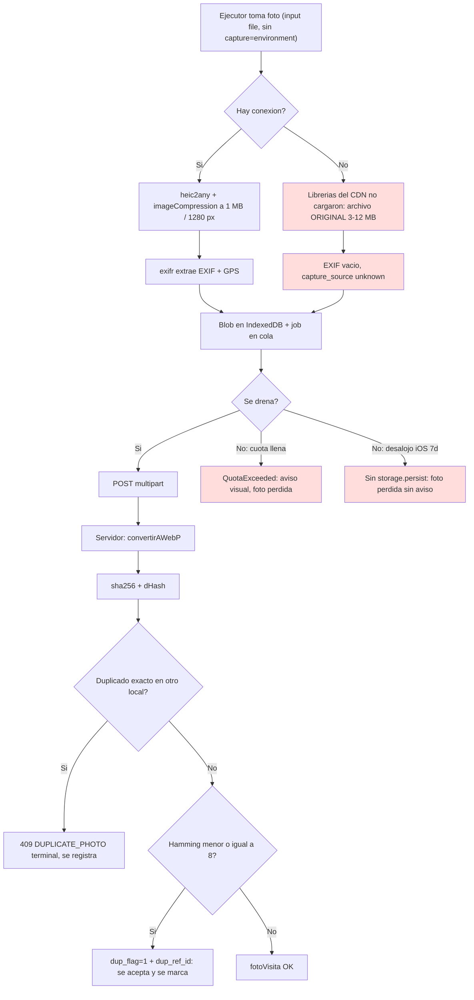
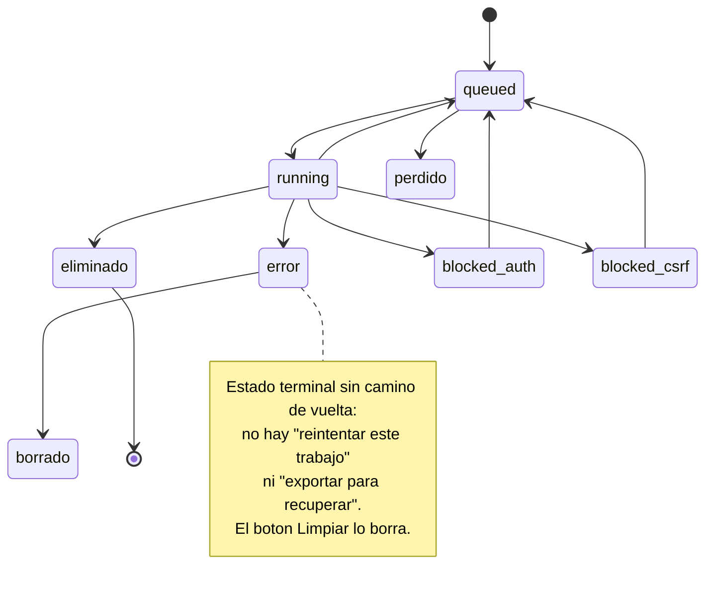
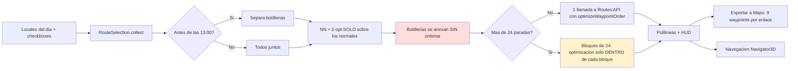
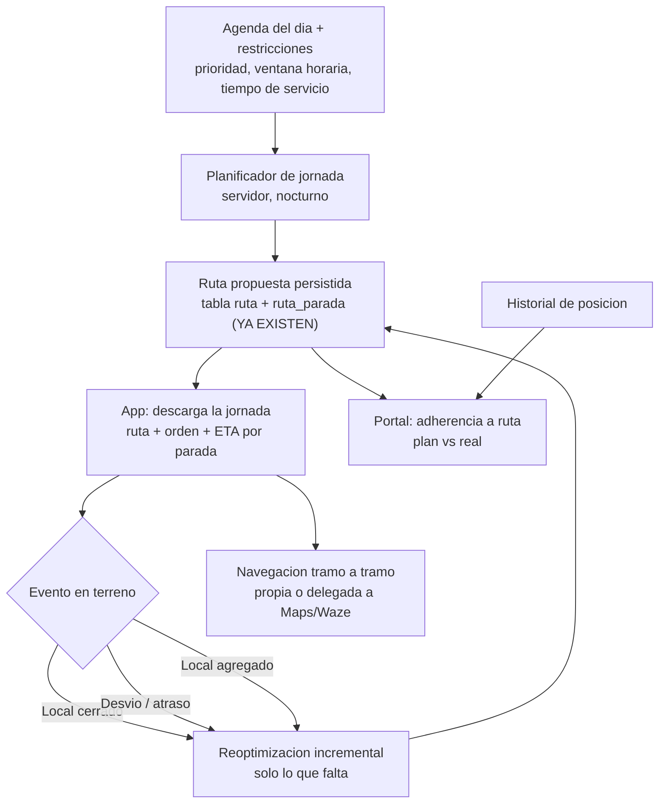
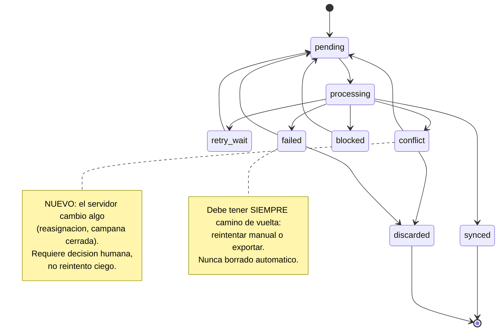
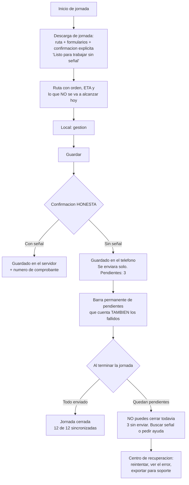
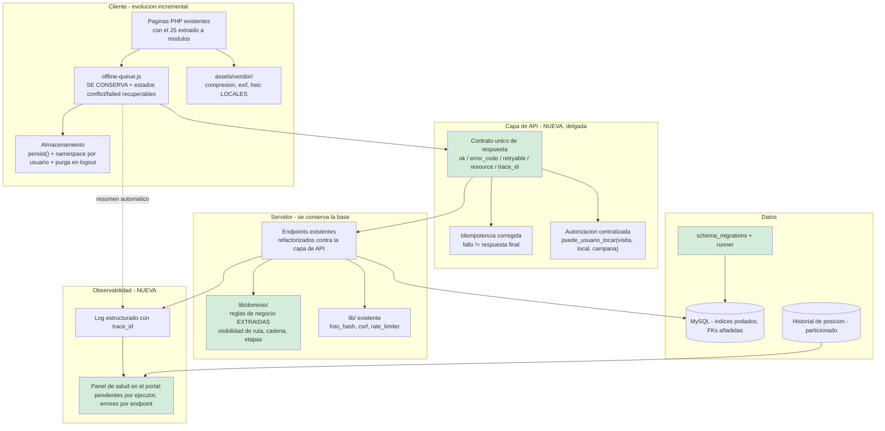

# Auditoría integral — Visibility App

**Fecha:** 03-09-2026 · **Alcance:** `app/` (PWA de terreno), endpoints PHP que consume, dump `visibility_visibility2 (34).sql` (1,7 GB, 99 tablas + 6 vistas), dependencias externas.

**Método:** lectura de código y esquema. **No se ejecutó nada** contra la base ni contra el servidor: no hay PHP CLI ni acceso a MySQL en este entorno, así que todo lo marcado *Confirmado* se sostiene en el código o el DDL, no en una prueba en caliente.

---

## Entregable 1 · Resumen ejecutivo

### Veredicto

**Visibility App es un producto funcional, con mucho trabajo bien hecho, montado sobre cimientos que ya no aguantan el peso que le están poniendo.** No es un prototipo ni un desastre: es un sistema real, en producción, con 253.000 visitas y 9,2 millones de respuestas de encuesta registradas. Pero está en el punto exacto en que **agregar funcionalidades nuevas cuesta más que arreglar lo que hay**.

Estado: **funcional pero frágil, con riesgo activo de pérdida de datos.**

### Lo que está bien, y hay que decirlo

- **El diseño offline es serio.** La cola tiene reintentos con backoff por tipo de error, dependencias entre trabajos, lock entre pestañas, recuperación de trabajos colgados y —lo más difícil de acertar— **valida el éxito lógico de la respuesta, no sólo el HTTP 200** (`isLogicalSuccess`, `offline-queue.js:721`). Mucha gente con más presupuesto no llega a eso.
- **La autenticación está bien hecha:** `password_verify` con rehash a Argon2id, CSRF con `hash_equals`, `session_regenerate_id`, remember-me con selector/hash separados, rate limit de login, fingerprint de sesión en base de datos.
- **La clave de Routes API está fuera del cliente** (`api/route_compute.php`), con validación de coordenadas y field mask en lista blanca.
- **La detección de fotos duplicadas** (sha256 exacto que bloquea + dHash perceptual que marca) es una respuesta técnicamente sólida a un problema real de negocio.
- **La bitácora del cliente** (`journal_db.js`) guarda por día el detalle de cada envío, con exportación de diagnóstico.

### Lo que está mal, en orden de gravedad

1. **Inyección SQL masiva y explotable en `app/ws.php`** — 118 KB, 65 llamadas a `query()`, **cero** `prepare()`, valores de `$_REQUEST` concatenados directo en SQL sobre tablas vivas (`usuario`, `local`, `visita`, `formulario`). Requiere sesión iniciada, o sea que cualquiera de los 476 usuarios —incluidos todos los ejecutores de terreno— puede leer o modificar la base completa.

2. **La idempotencia convierte errores transitorios en pérdida permanente.** Cuando `procesar_gestion_pruebas.php` falla, guarda el error 500 como respuesta *definitiva* de esa clave. Todos los reintentos reciben ese 500 grabado sin volver a ejecutar nada. **Una gestión que falla por un deadlock no se puede volver a enviar jamás.** La función que arregla esto (`idempo_mark_failed`) existe en el código y no se usa ahí.

3. **En un teléfono compartido, los datos de un ejecutor quedan disponibles para el siguiente.** `logout.php` limpia los cachés del service worker pero **no toca IndexedDB**, y no hay ni una llamada a `deleteDatabase` en todo el proyecto. La cola pendiente, las fotos, los borradores y la agenda del ejecutor A siguen ahí cuando entra B — y se envían con la sesión de B.

4. **El botón "Limpiar" del panel de cola borra gestiones que nunca se enviaron.** Llama a `AppDB.cleanup(0)`, que elimina los trabajos en estado `error` y `failed_permanent`. El texto de confirmación dice "historial de colas finalizadas".

5. **El almacenamiento del navegador no está declarado persistente.** No hay ninguna llamada a `navigator.storage.persist()`. En iOS, Safari borra los datos de un sitio a los 7 días sin uso; en Android, Chrome desaloja bajo presión de espacio. **Las fotos en cola son borrables por el sistema operativo sin aviso.**

6. **Offline, la app deja de comprimir fotos y de leer sus metadatos.** Las tres librerías que hacen ese trabajo se cargan desde `cdn.jsdelivr.net` y no están en el caché del service worker. Sin conexión —el escenario para el que existe la app— cada foto se encola al tamaño original de cámara (3–12 MB) y sin EXIF. Es la peor combinación posible: llena el almacenamiento justo cuando no se puede vaciar, y deja sin metadatos justo las fotos más difíciles de auditar.

7. **Problema serio de índices.** `form_question_responses` (9,2 M filas) tiene **45 índices**; `formularioQuestion` (758 K) tiene **38**; `local` (196 K) tiene **32**. Hay duplicados exactos. Al mismo tiempo, sólo hay **27 claves foráneas para 99 tablas**: `visita`, `fotoVisita` y `formularioQuestion` no tienen ninguna. Se paga el costo de escritura de un esquema sobre-indexado sin obtener la integridad de uno con restricciones.

### Estado por área

| Área | Estado | En una línea |
|---|---|---|
| Autenticación | **Bueno** | Bien construido; falla el control de inactividad (código muerto) y la sesión única molesta en terreno |
| Autorización | **Riesgoso** | IDOR en `visita_id`; `ws.php` sin control alguno |
| Offline / sincronización | **Buen diseño, contrato de errores roto** | La cola es buena; el servidor le miente sobre qué es recuperable |
| Fotos / evidencia | **Frágil** | Funciona online; offline pierde compresión, metadatos y potencialmente las fotos |
| Rutas | **Funcional, no optimizado** | Ordena puntos; no planifica una jornada |
| Base de datos | **Deuda alta** | Sobre-indexada, sin integridad referencial, sin migraciones |
| Seguridad | **Un crítico abierto** | `ws.php` |
| Observabilidad | **Buena en el cliente, ciega en el servidor** | Nadie ve un problema hasta que el ejecutor llama |
| Mantenibilidad | **Baja** | Archivos de 200 KB con PHP+HTML+JS; duplicación `_pruebas`; 1 test |

### Recomendación general

**Congelar funcionalidades nuevas durante un ciclo (4–6 semanas) y ejecutar la Fase 0 y la Fase 1 de la hoja de ruta.** No es una recomendación conservadora: los siete puntos de arriba son de bajo esfuerzo relativo —ninguno exige rediseñar el producto— y todos protegen datos que hoy se pueden perder. Seguir construyendo encima sin cerrarlos es acumular incidentes que después no se van a poder investigar, porque tampoco hay trazabilidad para hacerlo.

**No hace falta reescribir.** La arquitectura puede evolucionar de forma incremental. Hay que endurecer el contrato cliente–servidor, sacar la deuda que ya causa daño, y recién después seguir con rutas avanzadas y supervisión.

---

## Entregable 2 · Descripción funcional del producto actual

### Actores

| Actor | Dónde | Qué hace |
|---|---|---|
| **Ejecutor** | `app/` (PWA + APK) | Recibe agenda de locales por fecha, planifica ruta, navega, gestiona campañas en cada local, saca fotos, responde encuestas |
| **Editor / Admin** | `portal/` | Crea campañas, asigna locales y ejecutores, define formularios, aprueba solicitudes de cambio, revisa galerías y reportes |
| **MC (super-división)** | `portal/`, `division_id = 1` | Ve todas las divisiones y empresas |
| **Sistema** | cron implícito | GC de idempotencia (1 % de los requests), limpieza de rate limit (10 %) |

### Entidades centrales

`usuario` → `formularioQuestion` (asignación) → `visita` → `gestion_visita` (por material) + `form_question_responses` (encuesta) + `fotoVisita` / `form_question_photo_meta` (evidencia).

**`formularioQuestion` es la pieza clave y la peor nombrada del sistema.** No es "una pregunta de formulario": es la **asignación de trabajo**. Una fila = un material de una campaña en un local asignado a un ejecutor, con su estado (`countVisita`, `etapa_material`, `pregunta`), fecha propuesta y valor comprometido. Todo el negocio gira sobre esta tabla y su nombre no lo dice.

### Ciclo de una jornada, según el código

1. **Login** (`procesar_login.php`) → sesión PHP + fingerprint en `user_sessions` + cookie remember. **Revoca todas las demás sesiones del usuario.**
2. **Carga de agenda** (`index_pruebas.php`): consulta directa a MySQL, agrupa por `fechaPropuesta`, filtra fechas futuras si el usuario no tiene `puede_adelantar_ruta`, y **embebe el resultado completo como JSON en el HTML**.
3. **Siembra offline**: ese JSON se escribe en IndexedDB (`seedFromPHP`) y después se pide `api/sync_bundle.php` para reemplazarlo (con ETag/304 y modo delta).
4. **Planificación de ruta**: vecino más cercano + 2-opt sobre distancia geodésica, y luego la ruta real a Google Routes API vía proxy. Más de 24 paradas se parte en bloques encadenados.
5. **Gestión de un local** (`gestionarPruebas.php`, 199 KB): materiales, etapas, encuesta y fotos. Cada foto se comprime en el cliente y sube por su propio endpoint; el formulario final va a `procesar_gestion_pruebas.php`.
6. **Sin red**: todo se encola en IndexedDB (`v2_offline`) con dependencias (las fotos dependen de que exista la visita) y se drena al volver la conexión.
7. **Confirmación**: la cola valida `status: success`, marca el local como hecho en el caché local, borra el borrador y emite eventos que refrescan la UI.

### Flujos alternativos implementados

- **Local cerrado / no existe / mueble no existe** → estado `pendiente` o `cancelado` con motivo y foto obligatoria; escribe `formularioQuestion.pregunta = 'en proceso'` y el motivo en `observacion`. El local pasa a "Reagendados".
- **Implementación por etapas**: cada material recorre armado → entregado → implementado → retirado en visitas sucesivas. Implementación parcial permitida con motivo de una lista cerrada de dos strings.
- **Solicitudes de cambio** de dirección/geo y de vendedor: el ejecutor propone, el editor aprueba; mientras está pendiente, la coordenada nueva se sirve **sólo a ese ejecutor**.
- **Actividades complementarias** (`formulario.tipo = 2`, IW): encuestas sin local; incluye el piloto de odómetro con IA.

### Casos de error que el código sí maneja

Sesión expirada (bloquea la cola y reintenta rehidratar), CSRF vencido (refresca y reintenta), foto duplicada (409 terminal), visita aún no creada (503 `VISITA_PENDING`, reintenta rápido), Google Maps caído (fallback a DirectionsService), servidor que devuelve HTML en vez de JSON (distingue página de login de error de servidor).

### Casos de error que NO maneja

Almacenamiento del dispositivo lleno (sólo un aviso visual; la foto se pierde), cambio de usuario en el mismo dispositivo, dos dispositivos con la misma cuenta, formulario modificado mientras hay una gestión abierta, fallo transitorio del servidor en la gestión (queda envenenado), conflicto entre lo que el servidor cambió y lo que el dispositivo tenía en caché.

---

## Entregable 3 · Mapa de arquitectura actual



**Lo que el diagrama deja ver:** no hay capa de servicio, ni de acceso a datos, ni contrato de API. Cada página PHP habla SQL directo. `ws.php` es una puerta lateral a la base que nadie cerró. Y la dependencia con el CDN externo es la única flecha punteada porque es la única que se corta justo cuando la app más la necesita.

---

## Entregable 4 · Modelo de lógica de negocio

### Reglas reconstruidas desde el código

| # | Regla | Dónde está | Problema |
|---|---|---|---|
| R1 | Un local pendiente es visible mientras `countVisita = 0` | 5 lugares en `index_pruebas.php` + 2 en `sync_bundle.php`, como substring SQL repetido | Duplicada 7 veces; el propio CLAUDE.md pide mantenerla sincronizada con reemplazo global |
| R2 | En etapas, un material está listo si `etapa='retirado'` O (`='implementado'` Y `valor >= valor_propuesto`) | El mismo substring de R1 | Idem |
| R3 | Si la cadena del local tiene preguntas propias, ve SÓLO esas; si no, las generales | `gestionarPruebas.php`, `gestionar.php`, `gestion_bootstrap_mobile.php`, `procesar_gestion_pruebas.php`, `sync_bundle.php` | Implementada 5 veces por separado |
| R4 | Las botillerías abren a las 13:00 y van al final | `route_planner.js:180` + `cuenta.nombre LIKE '%botiller%'` | **La regla depende de una coincidencia de texto en el nombre de la cuenta** |
| R5 | Pendiente/cancelado exigen motivo | `procesar_gestion_pruebas.php:206` + cliente | Bien: está en ambos lados |
| R6 | El valor implementado no puede exceder el propuesto | `procesar_gestion_pruebas.php`, dentro de la transacción | Bien |
| R7 | Una foto exacta en la misma campaña y **otro** local se bloquea | `lib/foto_hash.php` + 3 endpoints | Bien diseñado |
| R8 | Sin `puede_adelantar_ruta` no se ven fechas futuras | `lib/ruta_permisos.php`, en 2 lugares | Bien |
| R9 | Una sola sesión activa por usuario | `revoke_other_sessions()` en login y rehidratación | Efecto colateral grave en terreno (V-10) |

**Reglas que viven sólo en el cliente:** el origen de la foto (`capture_source`), el límite de waypoints al exportar, el orden de la ruta, la obligatoriedad de foto por etapa en la UI.

**Contradicción estructural:** el estado general de una gestión se guarda en `formularioQuestion.pregunta` —una columna llamada "pregunta" que contiene `'en proceso'`, `'cancelado'`, `'implementado_auditado'`— **sin tocar `etapa_material`**. Por eso cada lector de estado tiene que consultar dos columnas y decidir cuál manda, y el CLAUDE.md documenta esa trampa como algo que hay que recordar. Eso no es una convención: es un modelo de datos incompleto.

### Ciclo de una visita



### Ciclo de una fotografía



### Ciclo de sincronización de un trabajo



### Ciclo de una ruta



---

## Entregable 5 · Inventario técnico

### Archivos que concentran el riesgo

| Archivo | Tamaño | Rol | Nota |
|---|---|---|---|
| `app/ws.php` | 118 KB | Servicio legacy | **SQLi. 0 prepare / 65 query. Sigue referenciado desde `usuario.js:248`** |
| `app/gestionarPruebas.php` | 199 KB | Formulario de gestión | PHP + HTML + ~2.500 líneas de JS inline |
| `app/index_pruebas.php` | 191 KB | Home / ruta / mapa | Idem; embebe la agenda como JSON |
| `app/gestionar.php` | 96 KB | Formulario legacy | Vivo para usuarios no migrados |
| `app/gestionarIW.php` | 59 KB | Complementarias | **Este es el vivo, no el `_pruebas`** |
| `app/procesar_gestion_pruebas.php` | 56 KB | Guardado de la gestión | Transaccional, pero idempotencia envenenada |
| `app/assets/js/offline-queue.js` | 80 KB | Motor de cola | Lo mejor construido del proyecto |
| `app/assets/js/journal_ui.js` | 79 KB | Bitácora visual | |
| `app/assets/js/nav_engine.js` | 42 KB | Navegación turn-by-turn | |

### Endpoints de escritura

`create_visita_pruebas.php` · `procesar_gestion_pruebas.php` · `upload_material_foto_pruebas.php` · `procesar_pregunta_foto_pruebas.php` · `procesar_pregunta_fotoIW.php` · `upload_estado_foto_pruebas.php` · `eliminar_material_foto_pruebas.php` · `eliminar_pregunta_foto_pruebas.php` · `guardar_recepcion_materiales.php` · `api/solicitud_cambio_local.php` · `api/solicitud_cambio_vendedor.php` · `api/gestion_draft_save.php` · `actualizar_ubicacion.php` · `ws.php`

**Sólo 6 usan `idempo_claim_or_fail`.** `actualizar_ubicacion.php`, `guardar_recepcion_materiales.php` y los dos de solicitudes de cambio no tienen idempotencia: un reintento de la cola crea una solicitud duplicada.

### Almacenamiento en el cliente

| Store | Base | Contenido | ¿Se purga en logout? |
|---|---|---|---|
| `queue` | `v2_offline` v10 | Trabajos + blobs de fotos | **No** |
| `gestion_drafts` | `v2_offline` | Borradores de gestión | **No** |
| `gestion_blobs` | `v2_offline` | Fotos de borradores | **No** |
| `agenda`/`locals`/`done` | `visibility2-v2` v9 | Caché de ruta | **No** |
| journal | base propia | Bitácora | **No** |
| mappings guid→visita | base propia | Correlación offline | **No** |
| `v2_agenda`, `v2_excluded`, `v2_camps_ocultas`… | localStorage | Agenda de respaldo y preferencias | **No** |
| `static-*`, `runtime-*` | Cache API | Assets y páginas | **Sí** |

### APIs externas

| Servicio | Uso | Riesgo |
|---|---|---|
| Google Maps JS API | Mapa, marcadores, geocoding del modal de dirección | Clave pública por diseño; **verificar restricción por referrer en Cloud Console** |
| Google Routes API v2 (`computeRoutes`) | Cálculo de ruta | Clave protegida; **sin límite de gasto por usuario** |
| Google DirectionsService | Fallback | Vigente |
| `cdn.jsdelivr.net` | `browser-image-compression@latest`, `heic2any@0.0.4`, `exifr`, `sweetalert2@11` | **Sin pinear, sin SRI, sin caché offline** |
| `cdnjs.cloudflare.com` | Font Awesome en `perfil.php` | Menor |

### Volumen de tablas (AUTO_INCREMENT del dump)

`form_question_responses` 9.204.195 · `formularioQuestion` 758.417 · `form_question_photo_meta` 707.762 · `request_log` 560.288 · `gestion_visita` 289.091 · `visita` 252.995 · `fotoVisita` 241.886 · `local` 196.580 · `gestion_draft` 94.717 · `usuario` 476 · `ubicacion_ejecutor` 59

---

## Entregable 6 · Matriz de hallazgos

Ordenada por severidad y prioridad. Estado de evidencia: **C** = Confirmado en código/DDL · **AP** = Altamente probable · **H** = Hipótesis · **IF** = Información faltante.

| ID | Área | Hallazgo | Ev. | Conf. | Evidencia técnica | Escenario de falla | Impacto de negocio | Sev. | Pri. | Causa raíz | Recomendación | Esf. |
|---|---|---|---|---|---|---|---|---|---|---|---|---|
| **V-01** | Seguridad | **SQL Injection en `ws.php`**: 65 `query()`, 0 `prepare()`, `$_REQUEST` concatenado sin escapar ni castear | C | Alta | `app/ws.php:243-270` — `INSERT INTO loc_region (...) VALUES ('$nombreRegion','$codigo',$idpais,1)` con `$idpais = $_REQUEST["idpais"]` sin comillas. `grep -c prepare(` = 0 | Un ejecutor con sesión válida envía `?ws=...&idpais=1,(SELECT...)` y lee/altera `usuario`, `local`, `visita`, `formulario` | Fuga total de datos de clientes, RUT, direcciones; manipulación de asignaciones y evidencias | **Crítica** | **P0** | Archivo legacy nunca migrado a sentencias preparadas y nunca retirado | **Retirar el archivo.** Sólo `usuario.js:248,273` lo llama; migrar esas dos llamadas a un endpoint nuevo con `prepare()` y borrar `ws.php` | S |
| **V-02** | Offline | **Idempotencia envenenada**: el fallo se guarda como respuesta definitiva y el reintento la reproduce | C | Alta | `procesar_gestion_pruebas.php:1001` llama `idempo_store_and_reply($conn,'procesar_gestion',500,...)`; eso hace `UPDATE request_log SET status='completed', status_code=500` (`lib/idempotency.php:287`). `idempo_claim_or_fail` caso 1 (línea 162) devuelve esa respuesta y `exit`. `idempo_mark_failed()` existe (línea 318) y **no se usa aquí** | Deadlock o lock timeout en la transacción → 500 grabado → los 6 reintentos son réplicas → job a `error` | **Pérdida silenciosa de gestiones completas.** El ejecutor cree que envió; el supervisor no ve el local | **Crítica** | **P0** | El helper trata el error como resultado final en vez de como intento fallido | Llamar `idempo_mark_failed()` en el catch. Reservar `idempo_store_and_reply` con código != 2xx sólo para rechazos de negocio deterministas (como el 409 de foto duplicada) | S |
| **V-03** | Privacidad / datos | **IndexedDB no se purga en logout ni se aísla por usuario** | C | Alta | `logout.php:101-115` sólo hace `postMessage CLEAR_USER_CACHES` al SW. `grep -rn "deleteDatabase" app/` = 0 resultados. Ningún store lleva `user_id` en la clave salvo `gestion_drafts` | A cierra sesión con 12 fotos en cola; B entra en el mismo teléfono; el drenaje envía los jobs de A con la sesión de B | Datos de A visibles para B; los jobs fallan con "No tienes permisos" (`procesar_gestion_pruebas.php:532`) y quedan envenenados por V-02 → trabajo de A perdido | **Crítica** | **P0** | El modelo de almacenamiento asume un dispositivo = un usuario | En logout: drenar o exportar lo pendiente, avisar si queda algo, y luego `indexedDB.deleteDatabase` de las 4 bases + limpiar las claves `v2_*` de localStorage. Guardar `user_id` en cada job y descartar en drain los que no sean del usuario actual | M |
| **V-04** | Offline | **El botón "Limpiar" borra gestiones nunca enviadas** | C | Alta | `index_pruebas.php` → `queueClearBtn` → `AppDB.cleanup(0)`. `db.js:317-338`: `isFinal = ['success','done','error','failed_permanent','canceled']`, borra si `finishedAt < cutoff`. Con `maxAgeDays=0`, cutoff = ahora | Ejecutor con un job en `error` toca "Limpiar" tras leer "historial de colas finalizadas" | Evidencia y gestiones destruidas sin traza local ni servidor | **Crítica** | **P0** | El botón mezcla "limpiar historial exitoso" con "descartar trabajo fallido" | Que `cleanup` acepte sólo `success`/`canceled`. Para los `error`, una pantalla aparte que exija exportar el diagnóstico antes de descartar | S |
| **V-05** | Offline | **Almacenamiento no persistente**: sin `navigator.storage.persist()` | C | Alta | `grep -rn "storage.persist" app/` = 0. `storage.estimate` sólo aparece en `journal_db.js:545`, dentro del payload de diagnóstico | iOS Safari borra los datos del origen a los 7 días sin uso; Chrome Android desaloja bajo presión | Fotos y gestiones en cola desaparecen sin aviso ni registro | **Crítica** | **P0** | Nunca se solicitó la promoción a almacenamiento persistente | Pedir `navigator.storage.persist()` al iniciar sesión; si se deniega, degradar visiblemente (avisar que no se puede trabajar offline con seguridad) | S |
| **V-06** | Fotos / offline | **Librerías críticas desde CDN externo, no cacheadas y sin pinear** | C | Alta | `gestionarPruebas.php:452-454` carga `browser-image-compression@latest`, `heic2any@0.0.4`, `exifr` desde jsdelivr. `sw.js:168` ignora todo origen cruzado; ninguna está en `STATIC_ASSETS`. Degradación: `compressFile` devuelve el original (`gestionarPruebas.php:2325`) y `extractPhotoMeta` devuelve todo vacío (`:2294`) | Ejecutor sin señal: cada foto se encola a 3–12 MB y sin EXIF | Cuota llena → V-05 y QuotaExceeded; subida lentísima al volver; **evidencia sin metadatos justo en las fotos menos verificables** | **Crítica** | **P0** | Dependencias de terceros tratadas como assets de página, no como parte del bundle offline | Descargar las 3 librerías al repo con versión fija, servirlas desde `assets/vendor/` y agregarlas a `STATIC_ASSETS`. Bonus: elimina `cdn.jsdelivr.net` del CSP | S |
| **V-07** | Autorización | **IDOR: `visita_id` de POST sin verificar propiedad** | C | Alta | `procesar_gestion_pruebas.php:402-403` — `if (isset($_POST['visita_id']) && intval(...)>0) { $visita_id = intval($_POST['visita_id']); }`. No hay `SELECT ... WHERE id=? AND id_usuario=?`. Ese id se usa en los INSERT de `fotoVisita`, `form_question_responses`, `gestion_visita` y en `UPDATE visita SET fecha_fin=NOW() WHERE id=?` | Un ejecutor postea el `visita_id` de otro y le adjunta fotos y respuestas, o le cierra la visita | Evidencia cruzada entre ejecutores; auditoría de terreno no confiable | **Alta** | **P1** | Se confía en un identificador del cliente que ya tiene camino seguro (el `client_guid`) | Verificar propiedad: `SELECT id FROM visita WHERE id=? AND id_usuario=? AND id_formulario=? AND id_local=?`. Si no calza, resolver por `client_guid` o rechazar con 403 | S |
| **V-08** | Evidencia | **`capture_source` es autodeclarado por el cliente** | C | Alta | `gestionarPruebas.php:2647` — `const captureSource = (sourceSelect && sourceSelect.value) \|\| 'gallery'`; se envía como campo de formulario (`:2459`). Ningún input tiene `capture="environment"` (8 `accept="image/*"`, 0 `capture`). El servidor lo guarda tal cual en `fotoVisita.capture_source` | Un ejecutor sube una foto de galería declarándola de cámara editando el select o el multipart | El campo parece un control antifraude y no lo es; decisiones de auditoría basadas en un dato autodeclarado | **Alta** | **P1** | Se modeló como dato, no como control | Derivar la fuente en el servidor con heurística EXIF (`DateTimeOriginal` presente, `Software` de edición, ausencia total de EXIF) y guardar la declaración del cliente como campo separado `capture_source_declarado` | M |
| **V-09** | Seguridad | **El control de inactividad de sesión es código muerto** | C | Alta | `_session_guard.php:315` — `if ($row && isset($row['last_seen_at']))`, pero `$row` viene de un `SELECT revoked_at` (línea 264) que **no selecciona `last_seen_at`**. La condición es siempre falsa | La variable `SESSION_INACTIVITY_MINUTES` no tiene efecto; las sesiones sólo mueren por revocación explícita o GC de PHP | Teléfono perdido o compartido conserva sesión válida indefinidamente | **Alta** | **P1** | Refactor que cambió el SELECT y no el consumidor | Agregar `last_seen_at` al SELECT y eliminar la segunda consulta redundante | S |
| **V-10** | Operación | **Sesión única por usuario revoca al dispositivo anterior sin avisar** | C | Alta | `procesar_login.php:210` y `_session_guard.php` (`try_rehydrate_session`) llaman `revoke_other_sessions()` incondicionalmente | Ejecutor entra desde otro teléfono o desde el portal; el teléfono con la cola pendiente pasa a `blocked_auth` (`offline-queue.js:846`) | Jornada completa bloqueada sin que nadie lo note hasta el cierre | **Alta** | **P1** | Política de seguridad aplicada sin considerar el modelo offline | Registrar dispositivos (`client_devices` ya existe) y permitir N sesiones por usuario con revocación explícita desde el portal. Como mínimo: avisar en la pantalla del dispositivo revocado qué quedó pendiente | M |
| **V-11** | Integridad | **La visita se inserta fuera de la transacción** | C | Alta | `procesar_gestion_pruebas.php:409` inserta en `visita`; `begin_transaction()` está en la línea 524 | Si la gestión falla, la visita queda con `fecha_fin = NULL` para siempre | `visita` (253 K filas) acumula registros huérfanos que distorsionan cualquier métrica de visitas realizadas | **Alta** | **P1** | La resolución de visita se hizo antes de abrir la transacción para poder responder rápido | Mover el INSERT dentro de la transacción, o marcar las visitas sin `fecha_fin` y más de 24 h como abandonadas en un job de limpieza | S |
| **V-12** | Offline | **Un 409 sin `error_code` se trata como éxito y se borra el job** | C | Media | `offline-queue.js:895` — "Otros 409 (duplicado real) - tratar como éxito lógico" → `{code:'DUPLICATE', success:true}` → `drain` hace `AppDB.remove(t.id)` (línea 1358). `api/gestion_draft_save.php:138` devuelve un 409 desnudo | Cualquier endpoint que use 409 para un conflicto de negocio hace que el job se borre sin haberse guardado | Pérdida silenciosa; el usuario ve "enviado" | **Alta** | **P1** | Se asumió que 409 siempre significa "ya existía y está bien" | Exigir `error_code` explícito para tratar un 409 como éxito. Sin él: error terminal visible | S |
| **V-13** | Rutas | **Las botillerías nunca pasan por el optimizador** | C | Alta | `route_planner.js:186-190` — `nearestNeighbor`/`twoOpt` se aplican sólo a `normales`; `const ordered = [...ordNormales, ...botillerias]` concatena las botillerías **en el orden en que vinieron del SQL** | Jornada de 20 locales con 8 botillerías antes de las 13:00: el 40 % final de la ruta va sin ordenar | Kilómetros y tiempo de más, todos los días, en la parte de la jornada donde más apura el reloj | **Alta** | **P1** | Optimización aplicada antes de la partición, no después | Aplicar `nearestNeighbor` + `twoOpt` también al bloque de botillerías, usando como origen la última parada normal | S |
| **V-14** | Seguridad | **Extensión de archivo tomada del nombre que envía el cliente** | C | Media | `procesar_gestion_pruebas.php:335,344` — `$extOrig = strtolower(pathinfo($origName, PATHINFO_EXTENSION) ?: 'jpg')`; si `convertirAWebP` devuelve `false`, se guarda como `$baseName.$extOrig` sin lista blanca. En el repo no existe un `.htaccess` para `uploads/` | Polyglot (imagen válida que Imagick y GD no pueden convertir) llamado `x.phtml` → queda escrito en un directorio servido por web | Ejecución remota de código si el servidor interpreta esa extensión en `uploads/` | **Alta** | **P1** | Ruta de respaldo escrita sin las validaciones de la ruta principal | Lista blanca `['jpg','jpeg','png','gif','webp']`; si no calza, rechazar. Y agregar un `.htaccess` en `uploads/` con `php_flag engine off` + `SetHandler default-handler` | S |
| **V-15** | Costos | **`route_compute.php` sin rate limit ni presupuesto por usuario** | C | Alta | `api/route_compute.php` valida sesión, método y payload; no llama a `rate_limit_check()` ni consulta cuota. El único registro es un `error_log` por llamada (línea 161) | Un bucle de recálculo (o un usuario con la pestaña abierta y GPS inestable) dispara llamadas facturables sin techo | Gasto en Google Maps sin control ni atribución | **Alta** | **P1** | El control de cuota quedó sólo en el cliente (`quota_monitor.js`, basado en localStorage y por lo tanto manipulable) | Aplicar `rate_limit_check($conn,'route_compute',$uid,60,60)` y registrar cada llamada en tabla para atribuir costo por usuario y por día | S |
| **V-16** | Base de datos | **Sobre-indexación severa e índices duplicados exactos** | C | Alta | `form_question_responses`: 45 índices sobre 9,2 M filas, con pares redundantes (`idx_fqr_q`/`idx_fqr_formq`/`id_form_question`, `idx_fqr_created`/`idx_fqr_created_at`). `formularioQuestion`: 38. `local`: 32. `request_log` tiene `uniq_req` y `uk_idempo` **idénticos**; `material` tiene `ux_mat_nombre_div` y `ux_material_nombre_division` idénticos; `visita` tiene `uq_visita_client_guid` y `uniq_visita_client_guid` idénticos | Cada INSERT en `form_question_responses` actualiza 45 árboles B+ | Escrituras lentas justo en el pico de sincronización de la tarde; espacio en disco y buffer pool desperdiciados | **Alta** | **P1** | Índices agregados uno a uno para arreglar consultas puntuales, sin retirar nunca los anteriores | Auditar con `sys.schema_unused_indexes` y `performance_schema`, eliminar duplicados exactos primero (riesgo cero) y luego los no usados. Objetivo: ≤ 12 índices en `form_question_responses` | M |
| **V-17** | Base de datos | **27 claves foráneas para 99 tablas; las tablas centrales no tienen ninguna** | C | Alta | `visita`, `fotoVisita`, `formularioQuestion`, `form_questions`, `form_question_options`, `gestion_apoyo`, `gestion_draft`, `sync_status`, `journal_event` no tienen FK. La única de `gestion_visita` es hacia `visita` | Se borra un local o una campaña y quedan `formularioQuestion`, `fotoVisita` y respuestas apuntando a nada | Reportes que no cuadran; imposible distinguir "dato faltante" de "dato huérfano" | **Alta** | **P2** | Esquema crecido sin restricciones para no bloquear cargas masivas | Añadir FKs en frío, empezando por `fotoVisita.visita_id` y `formularioQuestion.id_formulario/id_local/id_usuario`, previa limpieza de huérfanos. Requiere ventana de mantenimiento |  L |
| **V-18** | Rendimiento | **N+1 dentro de la transacción de gestión y join por texto** | C | Alta | `procesar_gestion_pruebas.php:908-912` — `prepare()` + `execute()` de `SELECT m.id FROM material m JOIN formularioQuestion fq ON fq.material = m.nombre` **dentro** del `foreach ($_POST['fotos'] as $idFQ => $urls)` | Gestión con 15 materiales = 15 prepares + 15 queries con la transacción abierta | Bloqueos más largos; contención en el pico de sincronización | Media | **P2** | Resolución de material por nombre en vez de por id, resuelta punto a punto | Precargar el mapa `idFQ → id_material` en una sola consulta antes del bucle. A mediano plazo: `formularioQuestion.id_material` como FK real |  S |
| **V-19** | Producto | **No hay historial de posición del ejecutor** | C | Alta | `ubicacion_ejecutor` tiene `UNIQUE KEY (id_ejecutor)` y `actualizar_ubicacion.php:33` hace `ON DUPLICATE KEY UPDATE`. 59 filas en total | Ante una visita disputada no se puede reconstruir dónde estuvo el ejecutor | Sin adherencia a ruta, sin prueba de presencia, sin poder investigar un reclamo de cliente | **Alta** | **P2** | Se guardó "última posición" para pintar un punto en el mapa, no para auditar | Tabla `ubicacion_ejecutor_historial` particionada por fecha, con muestreo cada 2–5 min sólo durante jornada activa y retención definida (ej. 90 días) | M |
| **V-20** | Rendimiento | **GC de idempotencia dentro del request del usuario** | C | Alta | `lib/idempotency.php:415` — `if (mt_rand(1,100)===1) idempo_gc($conn);` al incluir el archivo. `idempo_gc` hace 3 escrituras masivas sobre `request_log` (560 K filas), dos filtrando por `created_at`/`completed_at` sin índice adecuado (sólo existe `idx_timeout_cleanup(status,timeout_at)`) | 1 de cada 100 gestiones paga un escaneo completo de `request_log` | Timeouts esporádicos e inexplicables en el guardado, justo con red mala | Media | **P2** | Limpieza probabilística en línea en vez de tarea programada | Mover a un cron nocturno; mientras tanto, índice `(status, created_at)` y `(status, completed_at)` |  S |
| **V-21** | Privacidad | **El SW cachea `index_pruebas.php`, que contiene la agenda personal** | C | Media | `sw.js:10` incluye `index_pruebas.php` en `STATIC_ASSETS`; `networkFirst` cae a ese HTML como fallback de navegación (`sw.js:143`). El HTML embebe `$locales` y `$locales_reag` como JSON | Sin conexión, la app muestra la agenda capturada al instalar el SW; si `CLEAR_USER_CACHES` no alcanzó a correr, puede ser la de otro usuario | Datos de ruta desactualizados o de otra persona presentados como actuales | Media | **P2** | Página con datos personales tratada como asset estático | Cachear un `offline.html` neutro que se hidrate desde IndexedDB, y sacar `index_pruebas.php` de `STATIC_ASSETS` | M |
| **V-22** | Offline | **`procesar_gestion.php` y `procesar_gestion_pruebas.php` comparten la clave de endpoint** | C | Alta | Ambos llaman `idempo_claim_or_fail($conn,'procesar_gestion')`; la unicidad es `(idempotency_key, endpoint, user_id)` | Un usuario migrado a medias podría colisionar claves entre la versión vieja y la nueva | Réplica de una respuesta que corresponde a otro flujo | Baja | P3 | Convención `_pruebas` sin distinguir el endpoint lógico |  Usar `'procesar_gestion_v2'` en el archivo `_pruebas` | S |
| **V-23** | Seguridad | **El rate limiter falla abierto y cuesta 2 consultas por request** | C | Alta | `lib/rate_limiter.php:44,58,69,76` — todos los caminos de error devuelven `true` | Con la base bajo presión, el limitador deja pasar todo justo cuando más falta hace | Amplifica una caída en vez de contenerla | Media | P2 | Diseño deliberadamente "no romper el flujo" | Fallar cerrado en endpoints de escritura sensibles; y llevar el contador a APCu/Redis en vez de MySQL | M |
| **V-24** | Seguridad | **`user_security` (bloqueo por cuenta) existe y no se usa** | C | Alta | La tabla tiene `failed_count`, `lock_until`, `consecutive_locks`. `procesar_login.php:88-101` limita sólo por `(usuario, ip)`, 10 intentos / 15 min | Fuerza bruta distribuida desde varias IPs contra una cuenta | Compromiso de cuenta sin que salte ninguna alarma | Media | P2 | Se construyó el modelo y no se cableó | Cablear `user_security` en `procesar_login.php` con bloqueo temporal creciente y notificación al correo del usuario (`notify_email` ya está) | M |
| **V-25** | Seguridad | **CORS de la API móvil acepta cualquier `http://localhost:*`** | C | Alta | `_session_guard.php:22-24` y `api/mobile/_auth_mobile.php:15-16` | Una página local en la máquina del usuario puede llamar la API (necesita el token Bearer igualmente) | Bajo; superficie de ataque innecesaria en producción | Baja | P3 | Conveniencia de desarrollo dejada en producción | Condicionar los orígenes de localhost a `V2_TEST_MODE` o a un `APP_ENV=dev` | S |
| **V-26** | Higiene | **`error_log` de producción versionado en el repo** | C | Alta | `app/error_log`, 9 KB, con rutas absolutas `/home/visibility/public_html/...` y avisos de PHP. `.gitignore` cubre `*.log` pero no este nombre sin extensión | Cualquiera con acceso al repo ve la estructura del servidor | Bajo, pero es información gratuita para un atacante | Baja | P3 | El patrón de ignorados no cubre el nombre por defecto de cPanel | Añadir `error_log` al `.gitignore` y `git rm --cached` | S |
| **V-27** | Rutas | **La partición en bloques destruye la optimalidad global** | C | Alta | `route_planner.js:214` — `chunkPoints(ordered, 23)` reparte según el orden heurístico previo; `optimizeWaypointOrder` sólo reordena **dentro** de cada bloque | Jornada de 40 locales: la asignación de local a bloque la decide el vecino más cercano en línea recta | Ruta subóptima en las jornadas más largas, que son las que más importan | Media | P2 | Límite de la API resuelto partiendo, sin recomponer | Clusterizar geográficamente antes de partir (k-means sobre las coordenadas) y ordenar los clusters, en vez de cortar la secuencia cada 24 | M |
| **V-28** | Rutas | **La planificación ignora prioridad, relevancia, tiempo de servicio y jornada** | C | Alta | `route_planner.js:planFull` sólo usa distancia geodésica y la regla de botillería. `is_priority` y `relevancia` se leen en `index_pruebas.php` pero sólo pintan el marcador | Un local prioritario puede quedar último y no alcanzarse | Incumplimiento de compromisos con el cliente sin que el sistema lo advierta | Media | P2 | El planificador es un ordenador de puntos, no un planificador de jornada | Modelar costo = distancia + penalización por prioridad + ventana horaria; y estimar el cierre de jornada para avisar qué no va a alcanzar | L |
| **V-29** | Negocio | **La regla de las botillerías depende del texto del nombre de la cuenta** | C | Alta | `index_pruebas.php` — `stripos($row['tipo_cuenta'],'botiller') !== false` | Se renombra la cuenta a "Botilleria y Minimarket XYZ" o a "Bottle Store" y la regla se apaga o se enciende sola | Rutas mal ordenadas sin que nadie se entere | Media | P2 | Regla de negocio codificada como coincidencia de texto | Columna `cuenta.hora_apertura` (o una tabla de ventanas horarias por cuenta/cadena) y leer de ahí | M |
| **V-30** | Modelo | **El estado de la gestión vive en una columna llamada `pregunta`** | C | Alta | `formularioQuestion.pregunta varchar(80)` guarda `'en proceso'`, `'cancelado'`, `'implementado_auditado'`; `etapa_material` es un ENUM aparte que ese flujo no toca | Cada lector debe consultar dos columnas y decidir cuál manda; el CLAUDE.md documenta la trampa | Reportes divergentes entre módulos; onboarding lento | Media | P2 | Evolución del modelo por adición de columnas sin normalizar el estado | Columna `estado_gestion` con ENUM explícito, poblada desde las dos actuales, y una única función de lectura compartida | M |
| **V-31** | Base de datos | **Sin runner de migraciones** | C | Alta | `scripts/*.sql` numerados a mano; el CLAUDE.md documenta que el código debe protegerse con `SHOW COLUMNS`. `table_has_col()` en `procesar_gestion_pruebas.php:89` existe por eso | Nadie sabe qué scripts corrieron en producción; la memoria del proyecto lista 6 migraciones pendientes (12–15, 17, 21, 22, 23) | Código defensivo permanente; despliegues que fallan de forma distinta en cada ambiente | **Alta** | **P1** | Se decidió desacoplar despliegue de migración sin herramienta que lo sostenga | Tabla `schema_migrations` + script `migrate.php` que aplique lo pendiente en orden y registre. Es medio día de trabajo y elimina una clase entera de bugs | S |
| **V-32** | Base de datos | **Mezcla de utf8mb3 y utf8mb4 (62 tablas vs 37)** | C | Alta | `local`, `formularioQuestion`, `visita`, `fotoVisita` en utf8mb3; `gestion_visita`, `form_question_photo_meta`, `request_log` en utf8mb4 | Emojis y caracteres fuera del BMP se truncan en las tablas utf8mb3; joins por texto entre colaciones distintas no usan índice | Observaciones de terreno corrompidas; consultas cruzadas lentas | Media | P2 | Migración a utf8mb4 hecha a medias | Plan de conversión tabla por tabla a `utf8mb4_0900_ai_ci`, empezando por las que reciben texto libre | L |
| **V-33** | Calidad | **Un solo test en todo el producto** | C | Alta | `app/tests/navigator.spec.ts`, 299 bytes. Sin `package.json`, sin runner, sin CI | Cualquier cambio en la cola o en el guardado se valida sólo en el navegador, a mano | Miedo a tocar el núcleo; regresiones que aparecen en terreno | **Alta** | **P1** | Nunca se montó infraestructura de pruebas | Empezar por lo puro y testeable sin DOM: `route_planner.js`, `classifyFailure`, `isLogicalSuccess`, `normalize_foto_url`. Node + node:test, sin framework | M |
| **V-34** | Mantenibilidad | **Archivos de 200 KB con PHP, HTML y JS mezclados** | C | Alta | `gestionarPruebas.php` 199 KB, `index_pruebas.php` 191 KB, `gestionar.php` 96 KB | Un cambio exige leer miles de líneas; el CLAUDE.md documenta el bug recurrente de alcance entre el IIFE y el bloque global | Velocidad de desarrollo baja y decreciente | Media | P2 | Crecimiento orgánico sin extracción | Extraer el JS a `assets/js/` archivo por archivo, empezando por los bloques ya aislados (fotos, encuesta, etapas). Sin reescribir lógica | L |
| **V-35** | Observabilidad | **El servidor no ve nada de lo que pasa en los dispositivos** | C | Alta | La bitácora vive en IndexedDB; `api/journal_server.php` existe pero el envío es manual ("Exportar diagnóstico"). No hay tabla de estado de sincronización consultable salvo `sync_status`, que ningún endpoint de escritura actualiza | Soporte no puede responder "¿quién tiene cosas sin subir?" sin llamar uno por uno | Los incidentes se descubren cuando el cliente reclama | **Alta** | **P1** | La observabilidad se diseñó para depurar, no para operar | Envío automático del resumen de la bitácora al cerrar jornada o al recuperar red, y un panel en el portal con pendientes por ejecutor | M |
| **V-36** | Offline | **Endpoints sin idempotencia** | C | Alta | `actualizar_ubicacion.php`, `guardar_recepcion_materiales.php`, `api/solicitud_cambio_local.php`, `api/solicitud_cambio_vendedor.php` no llaman `idempo_claim_or_fail` | Un reintento de la cola crea una segunda solicitud de cambio idéntica | Editores revisando solicitudes duplicadas | Media | P2 | Idempotencia aplicada sólo a los endpoints "grandes" | Aplicar el mismo patrón; el helper ya existe | S |
| **V-37** | Código muerto | **`app/src/*.tsx` (prototipo React) y `gestionarIW_pruebas.php` sin uso** | C | Alta | `app/src/` no está referenciado por ningún build (no hay `package.json`); la memoria del proyecto confirma que el IW vivo es `gestionarIW.php` | Alguien edita el archivo equivocado | Trabajo perdido; ya pasó, está documentado en el CLAUDE.md | Baja | P3 | Versiones abandonadas que nunca se borraron | Borrar `app/src/`, `index_pruebas1.php`, `app/respaldo/` y los `*_pruebas` no usados, tras confirmar con `git log` | S |
| **V-38** | Fotos | **Sin política de retención ni límite de tamaño coherente** | C | Media | Cliente comprime a 1 MB / 1280 px; el servidor acepta hasta 50 MB y 8000×8000 (`convertirAWebP:264,282`). Imagick decodificando 8000×8000 usa ~256 MB de RAM | Varias fotos grandes concurrentes agotan la memoria de PHP | 500 en el guardado de fotos bajo carga | Media | P2 | Límites del servidor pensados para el peor caso, no para el caso real | Bajar el techo del servidor a 12 MB / 4000 px (muy por encima de lo que envía el cliente) y devolver 413 con mensaje claro | S |

---

## Entregable 7 · Auditoría de rutas

### Qué hace hoy, exactamente

1. **Selección**: `route_selection.js` lee los checkboxes visibles; sin tope de puntos.
2. **Preorden heurístico** (`route_planner.js:planFull`): separa botillerías si son antes de las 13:00, aplica vecino más cercano desde la posición GPS y luego 2-opt para camino abierto (correctamente implementado: no asume ciclo, es un detalle que suele estar mal).
3. **Cálculo real**: `RouteEngine.computeRouteUnified` → `api/route_compute.php` → Routes API v2. Tres modos:
   - `preview` → `TRAFFIC_UNAWARE` + `optimizeWaypointOrder`
   - `traffic` → `TRAFFIC_AWARE` + `departureTime` + optimización
   - `nav` → `TRAFFIC_AWARE_OPTIMAL` + `optimizeWaypointOrder: false` (correcto: Google prohíbe esa combinación)
4. **Caché**: memoria + IndexedDB, TTL 5 minutos, clave con coordenadas cuantizadas.
5. **Recálculo**: `routeStateHash` con el origen en cubos de ~50 m; el movimiento GPS sólo recalcula si superó 75 m y "Auto" está activo.
6. **Exportación**: bloques encadenados de 9 waypoints + destino.
7. **Navegación**: `Navigator3D` con proyección sobre la vía, detección de desvío, recálculo con backoff, voz por cola de prioridades y cámara 3D si hay Map ID vectorial.

### Calidad de la planificación: honestamente

**Esto ordena paradas; no planifica una jornada.** La diferencia importa:

| Factor | ¿Se considera? |
|---|---|
| Distancia geodésica | Sí |
| Distancia y tiempo por calle | Sí, pero **después** de decidir el orden |
| Tráfico | Sí, como modo opcional |
| Ventanas horarias | Sólo botillerías, una regla fija a las 13:00, por coincidencia de texto |
| Prioridad del local (`is_priority`) | **No** — sólo pinta el marcador |
| Relevancia (`local.relevancia`) | **No** |
| Tiempo de atención estimado por local | **No** |
| Hora de inicio y de término de jornada | **No** |
| Capacidad diaria / qué no se va a alcanzar | **No** |
| Punto de retorno o base | **No** |
| Rutas multi-día | **No** |

El preorden usa distancia en línea recta. En Santiago eso funciona razonablemente, pero produce órdenes malos donde la geometría engaña: dos locales a 300 m separados por la Costanera Norte o por el río quedan "juntos".

### Diferencia real con Waze / Google Maps

Hay que decirlo sin adornos: **una PWA no puede igualar a Waze, y no por falta de esfuerzo del equipo.**

- **En segundo plano no hay navegación.** Con la pantalla apagada el WebView se congela: se detiene `watchPosition`, no avanza el paso y no se detecta el desvío. El APK lo mitiga con `keepAwake` (que este mismo equipo agregó), pero eso mantiene la pantalla encendida y consume batería; no es multitarea real.
- **Sin mapas offline.** Si no hay señal, no hay tiles ni recálculo. Waze y Maps traen mapa descargado.
- **Sin datos de tráfico colaborativos** ni incidentes en tiempo real.
- **Precisión del GPS del navegador** menor que la del SDK nativo, sin fusión con acelerómetro ni giroscopio.

Lo que sí tiene y está bien resuelto: proyección sobre la vía (el punto azul no se va a la vereda), voz con cola de prioridades en vez de `cancel()` en cada frase, chips de estado, HUD que se repinta cada 15 s aunque no lleguen fixes (detalle fino: si no, la hora de llegada se congela con el vehículo detenido).

**Recomendación de expectativa:** posicionar la navegación como "guía de apoyo entre paradas", no como reemplazo de Waze, y hacer que el botón "Abrir en Google Maps" sea la vía principal para el tramo de conducción. La app debe ser dueña de **la jornada**; Waze puede ser dueño del **tramo**.

### Costos

Sin datos de facturación (información faltante), pero el orden de magnitud se puede estimar del código: `computeRoutes` con `TRAFFIC_AWARE` está en la banda de precio "Advanced/Preferred". Con 100 ejecutores × ~8 recálculos/día × 22 días ≈ 17.600 llamadas/mes, más las que provoque el GPS inestable. **Con V-15 abierto, ese número no tiene techo.**

### Arquitectura objetivo de rutas



**Las tablas `ruta`, `ruta_parada`, `ruta_set` y `ruta_set_detalle` ya existen en el esquema y la app no las usa.** Alguien ya modeló esto. Vale la pena revisar por qué quedó a medias antes de diseñar algo nuevo.

### Plan de evolución de rutas

1. **Ahora (P1):** arreglar V-13 (ordenar botillerías) y V-15 (límite de gasto). Dos días, mejora medible en km.
2. **Corto (P2):** persistir la ruta del día en `ruta`/`ruta_parada` para que sobreviva a recargas y cierres de app; clusterizar antes de partir en bloques (V-27).
3. **Medio (P2/P3):** ventanas horarias reales por cuenta (V-29), prioridad en la función de costo, estimación de cierre de jornada con aviso de "no vas a alcanzar estos 3".
4. **Largo (P3):** reoptimización dinámica durante la jornada y adherencia a ruta en el portal, apoyada en el historial de posición (V-19).

---

## Entregable 8 · Auditoría offline y sincronización

### Modelo actual

Cola en IndexedDB con estados `queued → running → (eliminado | queued | error | blocked_auth | blocked_csrf)`. Cada trabajo lleva un UUID estable generado en `enqueue` (`offline-queue.js:1526`) que viaja como `X-Idempotency-Key` y como campo `X_Idempotency_Key`. Las dependencias se expresan con `dependsOn: 'create:<client_guid>'` y se resuelven contra un mapa `client_guid → visita_id` persistido.

**Esto está bien pensado.** Los problemas no están en el motor: están en el contrato con el servidor.

### Idempotencia: el análisis completo

| Pregunta | Respuesta |
|---|---|
| ¿Una operación puede ejecutarse dos veces? | **Sí, en una ventana concreta.** Si el endpoint muere sin llegar al `catch` (fatal de PHP, timeout, caída de conexión), la fila queda en `processing`. Durante 2 minutos los reintentos reciben 409 `REQUEST_IN_PROGRESS`; **pasados los 2 minutos, el reintento "retoma" la clave y vuelve a ejecutar la lógica completa**. Si la primera ejecución alcanzó a hacer commit parcial fuera de la transacción (la visita, V-11), se duplica |
| ¿Hay `idempotency_key`? | Sí, estable y bien propagada |
| ¿El servidor reconoce reintentos? | Sí — y **demasiado bien**: también reconoce los fallos como definitivos (V-02) |
| ¿La base impide duplicados? | Parcialmente: `visita.client_guid` es UNIQUE (bien), `request_log(key,endpoint,user)` es UNIQUE. Pero `fotoVisita`, `form_question_responses` y `gestion_visita` no tienen restricción de unicidad de negocio; dependen del dedupe aplicativo (`foto_already_linked`) |
| ¿Qué pasa si el servidor guarda y el cliente no recibe la respuesta? | El reintento reproduce la respuesta guardada. **Este caso está bien resuelto** |
| ¿Y si el usuario toca "enviar" varias veces? | El `dedupeKey` de la cola y la clave de idempotencia lo cubren |

### El problema central: el servidor le miente al cliente sobre qué es recuperable

El cliente clasifica con cuidado (`classifyFailure`): sabe que 500 es reintentable, que 4xx no, que un 409 con `DUPLICATE_PHOTO` es terminal. Pero el servidor **guarda el 500 como respuesta final**, así que los reintentos que el cliente cree legítimos son réplicas de un error. El resultado es lo peor de los dos mundos: el cliente gasta 6 reintentos, el servidor no vuelve a intentar nada, y la gestión se pierde con la apariencia de haberlo intentado todo.

Además, los errores de validación (`"Valor excede valor_propuesto"`, `"No tienes permisos"`) salen por el mismo `catch` y se devuelven como **500**, no como 422. El cliente los reintenta 6 veces inútilmente.

### Orden y dependencias

- ¿Puede subirse una foto antes de crear la gestión? **Sí, por diseño**: las fotos se suben primero y la gestión referencia sus URLs. Si la gestión nunca llega, quedan **fotos huérfanas en disco y en `fotoVisita`** sin gestión asociada.
- ¿Puede cerrarse la visita antes de sincronizar respuestas? No: van en el mismo POST transaccional.
- ¿Hay trabajos huérfanos? Sí: `drain` los detecta a los 10 minutos y los marca `failed_permanent` con `MISSING_DEPENDENCY` (`offline-queue.js:1274`). Bien resuelto, pero termina en un estado del que no hay vuelta.

### Conflictos

**No hay ninguna estrategia de resolución de conflictos.** No hay versionado, ni `updated_at` comparado, ni ETag por registro. Escenario real: el editor reasigna un local a otro ejecutor mientras el primero está offline con la gestión hecha; al volver la red, el POST falla con "No tienes permisos" (la validación de `formularioQuestion` ya no encuentra la fila), sale por el `catch` como 500 y **queda envenenado**. El trabajo real, hecho en terreno, se pierde y nadie se entera.

### Escenarios reales de pérdida de datos

| Escenario | ¿Ocurre hoy? | Hallazgo |
|---|---|---|
| Fallo transitorio del servidor | **Sí** | V-02 |
| Cambio de usuario en el dispositivo | **Sí** | V-03 |
| Usuario toca "Limpiar" | **Sí** | V-04 |
| Desalojo del navegador (iOS 7 días) | **Sí** | V-05 |
| Cuota de almacenamiento agotada | **Sí** (avisa, pero pierde) | V-05, V-06 |
| Reasignación mientras está offline | **Sí** | V-02 + falta de conflictos |
| 409 sin `error_code` | **Sí** | V-12 |
| Limpieza de caché del navegador por el usuario | **Sí**, inevitable | Mitigable con `persist()` |
| Actualización del SW | No: la cola vive en IndexedDB, no en Cache API | Bien |
| Blob inválido | Improbable | |
| Respuesta no parseable | No: `parseResponseSafe` la maneja | Bien |

### Máquina de estados objetivo



### Contrato cliente–servidor recomendado

Toda respuesta de un endpoint de escritura:

```json
{
  "ok": true,
  "error_code": null,
  "retryable": false,
  "resource": { "type": "gestion", "id": 12345, "client_guid": "..." },
  "server_time": "2026-09-03T14:22:11-04:00",
  "trace_id": "ERR-1756..."
}
```

Reglas del contrato:

1. **`retryable` lo decide el servidor**, no el cliente. El cliente sólo obedece.
2. **Un error nunca se persiste como respuesta idempotente**, salvo que sea un rechazo de negocio determinista (misma entrada → mismo rechazo siempre). El 409 de foto duplicada califica; un 500 por deadlock no.
3. **Errores de validación devuelven 422 con `retryable: false`**; errores de infraestructura devuelven 5xx con `retryable: true` y **la clave marcada como `failed`**, no `completed`.
4. **Conflictos de estado devuelven 409 con `error_code` explícito** (`ASSIGNMENT_CHANGED`, `CAMPAIGN_CLOSED`, `VISIT_ALREADY_CLOSED`) y el cliente los manda a la bandeja de conflictos, no a la papelera.
5. **El identificador persistido siempre vuelve en la respuesta**, para que el cliente confirme contra algo real antes de borrar el trabajo local.

---

## Entregable 9 · Auditoría de fotografías, memoria y blobs

### Ciclo actual

Captura (`input[type=file][accept=image/*]`, sin `capture`) → si es HEIC, `heic2any` → `browser-image-compression` a 1 MB / 1280 px / JPEG → `exifr` extrae EXIF y GPS → `URL.createObjectURL` para la miniatura → subida inmediata por endpoint propio, o encolado con el blob en IndexedDB → servidor convierte a WebP (Imagick, con GD de respaldo), calcula sha256 y dHash, decide bloqueo o marca, e inserta en `fotoVisita` o `form_question_photo_meta`.

### Memoria: estado tras el trabajo reciente

El registro `V2Blobs` que se agregó recientemente cierra el agujero principal: cada `createObjectURL` queda registrado, se libera al reemplazar por la URL del servidor, y hay una liberación total en `pagehide` que respeta el bfcache. También se dejaron de retener los archivos originales de cámara en closures (`fd.rawFile = null` al terminar la fase de subida). **Ese trabajo estaba bien dirigido.**

Lo que queda pendiente de verificar en dispositivo: que `V2Blobs.vivas()` vuelva cerca de 0 tras subir un lote. Sin eso, es código correcto pero no probado.

### Lo que sigue mal

| Problema | Evidencia | Consecuencia |
|---|---|---|
| **Sin compresión offline** | V-06 | La foto entra a IndexedDB a 3–12 MB en vez de ~1 MB. Diez fotos = 100 MB en vez de 10 MB |
| **Sin EXIF offline** | V-06 | `exif_datetime`, `exif_lat/lng`, `exif_make/model` vacíos. La validación geográfica de 200 m del portal no puede correr sobre esas fotos |
| **HEIC sin convertir offline** | `compressFile:2322` devuelve el original | La miniatura queda rota en Android y el servidor tiene que convertir un formato que quizá no soporta |
| **`capture_source` autodeclarado** | V-08 | El control antifraude no es un control |
| **Sin almacenamiento persistente** | V-05 | El sistema operativo puede borrar las fotos |
| **Fotos huérfanas** | Las fotos se suben antes que la gestión | Si la gestión nunca llega, quedan archivos en disco y filas en `fotoVisita` sin gestión. **No hay proceso que los detecte** |
| **Sin retención definida** | No hay job de limpieza de `uploads/` | El disco crece indefinidamente; 242 K fotos y subiendo |
| **Techo del servidor desproporcionado** | V-38 | 50 MB / 8000×8000 con Imagick = riesgo de agotar memoria |

### Integridad de la evidencia: qué protege realmente hoy

| Control | ¿Existe? | ¿Es falsificable? |
|---|---|---|
| Hash criptográfico (sha256) | Sí, servidor | No |
| Hash perceptual (dHash 64 bits) | Sí, servidor | No |
| Bloqueo de reuso entre locales | Sí, misma campaña | No |
| Bloqueo de reuso entre **campañas** | **No** | La misma foto sirve en dos campañas distintas |
| GPS de la foto vs coordenada del local | Sí, en el portal (radio 200 m) | Sí: el GPS del formulario lo envía el cliente |
| Fecha de captura EXIF | Sí, cuando hay EXIF | Sí: EXIF es editable |
| Origen cámara/galería | Sí en la columna | **Sí, trivialmente** (V-08) |
| Vínculo inmutable foto ↔ visita | **No** | No hay firma ni hash encadenado |

**Diagnóstico honesto:** el sistema detecta bien el fraude **perezoso** (reusar la misma foto), que es probablemente el 90 % de los casos reales. No detecta al que se toma el trabajo de sacar fotos distintas en otro lado, porque los únicos datos que lo delatarían (GPS y hora) los aporta el propio cliente.

### Política objetivo

```
CAPTURA     capture="environment" donde el negocio exija cámara;
            declaración del cliente como pista, nunca como verdad.
COMPRESIÓN  1600 px lado mayor, calidad 0.75, techo 1,5 MB.
            Librerías locales: debe funcionar igual offline.
METADATOS   EXIF siempre (librería local) + GPS del dispositivo con
            precisión y timestamp + sha256 calculado EN EL CLIENTE
            y verificado en el servidor.
FUENTE      Derivada en servidor por heurística EXIF; la declaración
            del cliente va en columna aparte y se comparan.
ALMACÉN     storage.persist() obligatorio; aviso al 80 % de cuota;
            bloqueo de captura al 95 % con mensaje explícito.
LIMPIEZA    Blob borrado sólo tras confirmación funcional del servidor.
            Job semanal que cruce uploads/ contra fotoVisita y reporte
            huérfanos (reportar, no borrar).
RETENCIÓN   Fotos de campañas cerradas hace más de N meses a almacenamiento
            frío. Definir N con el cliente.
DEDUPE      Extender el bloqueo exacto a nivel de campaña cruzada,
            con lista de excepciones por material genérico.
```

---

## Entregable 10 · Auditoría de base de datos

### Diccionario resumido de las tablas del núcleo

| Tabla | Filas aprox. | Propósito | Riesgo |
|---|---|---|---|
| `formularioQuestion` | 758 K | **La asignación de trabajo**: usuario + campaña + local + material, con estado y fecha | 38 índices; sin FK; el estado en la columna `pregunta`; `valor`/`valor_propuesto` como `varchar` con casts a UNSIGNED en las consultas |
| `visita` | 253 K | Sesión de trabajo en un local | Sin FK; `client_guid` con **tres** índices únicos equivalentes; visitas huérfanas sin `fecha_fin` |
| `gestion_visita` | 289 K | Detalle por material de cada visita | Única FK del núcleo; `id_material` puede quedar en 0 por el join por texto |
| `form_question_responses` | 9,2 M | Respuestas de encuesta | **45 índices**; `answer_text_norm` generada (bien); sin FK a `form_questions` |
| `fotoVisita` | 242 K | Evidencia de materiales | Sin FK; `url_hash` generada con normalización de rutas (buena solución a un problema autoinfligido) |
| `form_question_photo_meta` | 708 K | Evidencia de encuesta | FK a `form_question_responses` con CASCADE (bien) |
| `local` | 197 K | Maestro de salas | 32 índices; `UNIQUE(codigo, id_division)` (bien); `lat/lng decimal(10,7)` (precisión correcta) |
| `request_log` | 560 K | Idempotencia | Dos únicos idénticos; sin índice para el GC por fecha |
| `gestion_draft` | 95 K | Patrón SAGA de gestiones | Bien diseñada; **el `status` que escribe no lo consume ningún proceso de recuperación** |
| `sync_status` | — | Estado de sincronización por local | **Modelada y no cableada**: ningún endpoint la escribe |
| `ubicacion_ejecutor` | 59 | Última posición | `UNIQUE(id_ejecutor)`: por diseño, sin historial |

### Problemas de integridad

1. **27 FK / 99 tablas.** Las tablas del núcleo transaccional no tienen ninguna.
2. **Relaciones por texto**: `formularioQuestion.material` ↔ `material.nombre`. Renombrar un material rompe el vínculo silenciosamente.
3. **Números guardados como texto**: `formularioQuestion.valor` y `valor_propuesto` son `varchar(80)` y las consultas hacen `CAST(COALESCE(NULLIF(fq.valor,''),'0') AS UNSIGNED)`. Eso impide usar índices y esconde datos inválidos.
4. **Estados como strings mágicos** sin ENUM ni tabla de referencia: `'en proceso'`, `'implementado_auditado'`, `'solo_retirado'`, `'gestion_material'`.
5. **`observacion varchar(360) NOT NULL`** sin valor por defecto, usada además como cajón (`" | Foto: $url"` concatenado).
6. **Mezcla de colaciones** (V-32).
7. **Borrado lógico inconsistente**: `formulario`, `local`, `form_questions` tienen `deleted_at`; `formularioQuestion`, `visita`, `fotoVisita` no.

### Índices: qué eliminar primero (riesgo cero)

```sql
-- Duplicados exactos. Eliminar el segundo de cada par no cambia ningún plan.
ALTER TABLE request_log  DROP INDEX uk_idempo;                    -- = uniq_req
ALTER TABLE material     DROP INDEX ux_material_nombre_division;  -- = ux_mat_nombre_div
ALTER TABLE visita       DROP INDEX uniq_visita_client_guid;      -- = uq_visita_client_guid

-- Prefijos redundantes: cubiertos por índices compuestos que ya empiezan igual.
ALTER TABLE form_question_responses
  DROP INDEX idx_fqr_q,            -- prefijo de idx_fqr_q_opt
  DROP INDEX idx_fqr_formq,        -- idem
  DROP INDEX idx_fqr_created,      -- prefijo de idx_fqr_created_at_id
  DROP INDEX idx_fqr_visita,       -- prefijo de idx_fqr_visita_pregunta
  DROP INDEX idx_fqr_user,         -- prefijo de idx_fqr_usuario_created
  DROP INDEX idx_fqr_local;        -- prefijo de idx_fqr_local_created

ALTER TABLE formularioQuestion
  DROP INDEX id_formulario,        -- = idx_id_formulario
  DROP INDEX idx_formularioQuestion_formulario,
  DROP INDEX idx_fq_formulario,
  DROP INDEX idx_fq_fecha,         -- = fq_idx_fecha = idx_fq_fecha_propuesta
  DROP INDEX idx_fq_pregunta;      -- = fq_idx_pregunta
```

**No ejecutar a ciegas.** Antes: `SELECT * FROM sys.schema_redundant_indexes;` y `sys.schema_unused_indexes` con al menos un mes de estadísticas, y respaldo previo.

### Índices que sí faltan

```sql
-- V-20: el GC de idempotencia hace escaneo completo hoy.
ALTER TABLE request_log ADD INDEX idx_rl_status_created (status, created_at);
ALTER TABLE request_log ADD INDEX idx_rl_status_completed (status, completed_at);

-- Detección de visitas huérfanas (V-11).
ALTER TABLE visita ADD INDEX idx_visita_abiertas (fecha_fin, fecha_inicio);
```

### Transacciones y concurrencia

| Operación | ¿Transaccional? |
|---|---|
| Guardado de la gestión | **Sí** (`procesar_gestion_pruebas.php:524-952`) — bien hecho |
| Creación de la visita | **No** — fuera de la transacción (V-11) |
| Subida de foto | No, y no lo necesita: es una fila |
| Claim de idempotencia | Sí, `SELECT ... FOR UPDATE` con commit inmediato — correcto |
| Recepción de materiales | Verificar (no auditado en detalle) |
| Aprobación de solicitud de cambio | Verificar: actualiza tablas maestras y auto-rechaza competidoras; **debería ser transaccional** |

### Evolución del esquema

No hay sistema de migraciones (V-31). `scripts/*.sql` se corren a mano por phpMyAdmin. El código se defiende con `SHOW COLUMNS` en caliente. La memoria del proyecto lista **seis migraciones pendientes de aplicar**. Eso significa que hoy nadie puede afirmar con certeza qué versión del esquema está en producción.

---

## Entregable 11 · Auditoría de seguridad

### Activos

Credenciales (Argon2id, bien), datos personales de ejecutores (RUT, teléfono, correo, dirección), maestro de 197 K locales con direcciones y coordenadas, 242 K fotografías de puntos de venta, respuestas de encuesta de clientes, posición del ejecutor, claves de Google Maps.

### Amenazas y estado

| Amenaza | Estado | Detalle |
|---|---|---|
| **SQL Injection** | **ABIERTA** | V-01, `ws.php` |
| **IDOR** | **ABIERTA** | V-07, `visita_id` |
| XSS | Mitigada | `htmlspecialchars` sistemático + CSP; pero `'unsafe-inline'` en `script-src` la debilita |
| CSRF | Mitigada | Token con `hash_equals`, validado en los endpoints de escritura |
| Robo de sesión | Parcial | Fingerprint + revocación; **pero la inactividad no expira** (V-09) |
| Dispositivo compartido | **ABIERTA** | V-03 |
| Dispositivo perdido | **ABIERTA** | V-09 + V-03: sesión eterna y datos locales intactos |
| Fuerza bruta distribuida | Parcial | V-24 |
| Subida de archivo malicioso | **Probable** | V-14 |
| Falsificación de visita | **ABIERTA** | Coordenadas y `capture_source` los aporta el cliente sin verificación cruzada |
| Reuso de fotos | Bien mitigada | Salvo entre campañas |
| Exposición de claves | Bien | Routes API en servidor; Maps JS pública por diseño (verificar restricción por referrer) |
| Logs con datos personales | Menor | `route_compute.php` registra `uid` (aceptable); `app/error_log` versionado (V-26) |
| Retención indefinida de ubicación | No aplica | Sólo se guarda la última |

### Mitigaciones por prioridad

**P0** — Retirar `ws.php`. Verificar propiedad de `visita_id`. Lista blanca de extensiones + `.htaccess` en `uploads/`. Purgar IndexedDB en logout.

**P1** — Arreglar el control de inactividad. Cablear `user_security`. Restringir CORS de localhost a desarrollo. Sacar `error_log` del repo.

**P2** — Migrar de `'unsafe-inline'` a nonces por request (requiere extraer el JS inline, V-34). Derivar `capture_source` en el servidor. Firmar el payload de la gestión para que el vínculo foto ↔ visita sea verificable.

### Retención y privacidad

Hoy **no hay política de retención de nada**: ni fotos, ni respuestas, ni bitácora, ni `request_log` (más allá del GC de 30 días), ni logs de duplicados. Para un sistema que guarda fotos de puntos de venta y datos de personas identificables, eso debería definirse por escrito con el cliente. Y si se implementa el historial de posición (V-19), la retención pasa de recomendable a obligatoria: rastrear a trabajadores exige propósito declarado, plazo acotado y acceso restringido.

---

## Entregable 12 · Auditoría UX/UI

### El usuario real

Un ejecutor con el teléfono en una mano, apurado, en la puerta de un local, con sol de frente, señal irregular y un teléfono que probablemente no es de gama alta. No es un usuario técnico y **necesita certeza**, no información.

### Puntos de ansiedad detectados en el código

| Momento | Qué ve el ejecutor | Qué pasa en realidad |
|---|---|---|
| Después de guardar una gestión sin señal | La gestión "se envió" | Está en cola; puede fallar horas después y quedar envenenada (V-02) |
| Foto en cola | Sin indicación de peso ni de cuánto falta | Puede estar consumiendo 12 MB (V-06) |
| Panel de cola dice "Cola: 0" | Todo listo | Los trabajos en `error` **no cuentan** en `pending`; puede haber 5 gestiones perdidas y el contador dice 0 |
| Botón "Limpiar" | "Historial de colas finalizadas" | Borra gestiones fallidas (V-04) |
| Sesión revocada desde otro dispositivo | Errores raros que no explica nadie | Cola bloqueada (V-10) |
| Almacenamiento lleno | Un alert amarillo | La foto ya se perdió |
| Cambio de usuario en el teléfono | Nada | Los datos del anterior siguen ahí (V-03) |

**El peor de todos es el tercero.** El indicador principal de "¿está todo subido?" no cuenta los fallos. Un ejecutor puede terminar su jornada, ver "Cola: 0", irse a su casa, y tener cinco gestiones perdidas.

### Aciertos de UX que vale la pena conservar

Bitácora con calendario y colores por estado. Toasts no bloqueantes con acciones (en vez de `alert()`). Numeración de paradas en marcadores y filas. Aviso explícito cuando la ruta se parte en bloques. Chips de estado en la navegación. Modal de "¿Cómo funciona?" escrito en el idioma del ejecutor, no en el del programador. **Esto último es raro de ver y está muy bien.**

### Flujo mejorado propuesto



### Cambios concretos recomendados

1. **El contador de pendientes debe incluir los fallidos.** Es un cambio de una línea y elimina el peor punto de ansiedad del producto.
2. **Cierre de jornada explícito** con verificación: "12 de 12 gestiones sincronizadas". Si no, no deja cerrar y ofrece el centro de recuperación.
3. **Centro de recuperación**: pantalla que lista lo fallido con el motivo en castellano, botón de reintentar y botón de exportar para soporte. Hoy un trabajo en `error` es un callejón sin salida.
4. **Indicador de espacio** cuando se supere el 80 % de la cuota, antes de que se pierda algo.
5. **Peso de la foto en la tarjeta** cuando supere 2 MB, con aviso de que se subirá más lento.
6. **Confirmación honesta al guardar**: "Guardado en el teléfono, se enviará solo" es la verdad; "Enviado" es mentira sin señal.

---

## Entregable 13 · Arquitectura objetivo

**No propongo reescritura.** La arquitectura actual puede evolucionar de forma incremental, y hay partes que merecen conservarse tal cual.



### Qué se conserva

`offline-queue.js` (el motor está bien), `lib/foto_hash.php`, `lib/idempotency.php` (corregido, no reemplazado), `api/route_compute.php`, `api/sync_bundle.php` con su ETag/delta, el sistema de autenticación, `route_planner.js` (las funciones puras son buenas y testeables).

### Qué se extrae

Las reglas de negocio duplicadas (R1, R2, R3 de la tabla del Entregable 4) a `lib/dominio/`. La autorización a una función única. El JS inline de las páginas grandes a módulos.

### Qué se reemplaza

`ws.php` (borrar). El contrato de respuestas (nuevo, unificado). El mecanismo de migraciones (nuevo). La política de almacenamiento del cliente (persistente + por usuario).

### Qué se agrega

Panel de salud en el portal. Log estructurado con `trace_id` correlacionado entre cliente y servidor (el `error_id` de `generate_error_id()` ya es la semilla). Historial de posición. Pruebas de las funciones puras.

---

## Entregable 14 · Backlog de nuevos requerimientos

### Bloque A · Estabilización

---

**A-1 · Contrato de errores y recuperación de gestiones fallidas**

- **Problema:** V-02, V-12. Una gestión que falla por causa transitoria se pierde para siempre.
- **Usuario:** ejecutor (no pierde su trabajo), supervisor (no le faltan locales), soporte (puede diagnosticar).
- **Valor de negocio:** elimina la principal causa de pérdida de datos del producto. Cada gestión perdida es una visita a terreno pagada que no se puede facturar ni demostrar.
- **Descripción:** unificar el formato de respuesta de todos los endpoints de escritura; el servidor decide `retryable`; los fallos no se persisten como respuesta idempotente; los conflictos de estado llevan `error_code` explícito.
- **Reglas:** 5xx → `idempo_mark_failed`, `retryable: true`. 422 → validación, `retryable: false`. 409 con `error_code` → conflicto, va a la bandeja. 409 sin `error_code` → **error**, nunca éxito.
- **Dependencias:** ninguna.
- **Riesgos:** cambiar la clasificación de errores puede alterar el comportamiento de reintento en producción; desplegar con la bitácora observada de cerca la primera semana.
- **Complejidad:** M · **Prioridad:** P0
- **Historia:** *Como ejecutor, cuando el envío de mi gestión falla por un problema del servidor, quiero que se reintente de verdad y, si no se puede, poder verlo y recuperarlo, para no perder una visita que ya hice.*
- **Criterios de aceptación:**
  - Dado un endpoint que lanza excepción, cuando el cliente reintenta con la misma clave, entonces la lógica se ejecuta de nuevo (no se replica el error).
  - Dado un error de validación, entonces se devuelve 422 y el cliente no lo reintenta.
  - Dado un trabajo en `error`, entonces aparece en el centro de recuperación con motivo legible y botón de reintentar.
- **Métrica de éxito:** gestiones en estado `error` sin resolver al cierre de jornada < 0,5 % de las creadas.

---

**A-2 · Aislamiento y persistencia del almacenamiento local**

- **Problema:** V-03, V-05.
- **Usuario:** ejecutor y responsable de datos personales.
- **Valor:** cierra dos vías simultáneas de pérdida y una de fuga entre personas.
- **Descripción:** `navigator.storage.persist()` al iniciar sesión; `user_id` en cada registro local; purga completa de IndexedDB y de las claves `v2_*` de localStorage al cerrar sesión, con aviso previo si hay pendientes.
- **Reglas:** no se puede cerrar sesión con trabajos pendientes sin confirmación explícita que advierta la pérdida. El drenaje descarta trabajos cuyo `user_id` no sea el de la sesión actual.
- **Complejidad:** M · **Prioridad:** P0
- **Historia:** *Como ejecutor que comparte teléfono, quiero que al cerrar sesión no quede nada mío en el dispositivo y que nadie más pueda enviar mi trabajo por error.*
- **Criterios:** tras logout, `indexedDB.databases()` no devuelve bases de la app · con pendientes, el logout advierte y exige confirmación · un trabajo del usuario A nunca se envía en la sesión de B.
- **Métrica:** cero incidentes de "gestión atribuida a quien no la hizo".

---

**A-3 · Librerías de foto locales y compresión garantizada offline**

- **Problema:** V-06. **Prioridad:** P0 · **Complejidad:** S
- **Historia:** *Como ejecutor sin señal, quiero que mis fotos se compriman y conserven sus datos igual que con señal, para que quepan en el teléfono y sirvan como evidencia.*
- **Criterios:** con el modo avión activado, una foto de 8 MB se encola pesando menos de 1,5 MB y con `exif_datetime` no vacío · ninguna petición a `cdn.jsdelivr.net` desde `gestionarPruebas.php` · `cdn.jsdelivr.net` sale del CSP.
- **Métrica:** peso medio del blob en cola offline < 1,5 MB; porcentaje de fotos con EXIF > 95 % independiente del estado de red.

---

**A-4 · Retirar `ws.php` y cerrar el IDOR de `visita_id`**

- **Prioridad:** P0 · **Complejidad:** S
- **Criterios:** `ws.php` no existe en el repo ni en el servidor · las dos llamadas de `usuario.js` funcionan contra un endpoint con `prepare()` · un POST a `procesar_gestion_pruebas.php` con el `visita_id` de otro usuario devuelve 403.

---

**A-5 · Runner de migraciones**

- **Problema:** V-31. **Prioridad:** P1 · **Complejidad:** S
- **Criterios:** tabla `schema_migrations` · `php scripts/migrate.php` aplica lo pendiente en orden y es idempotente · las 6 migraciones pendientes quedan registradas como aplicadas.

---

### Bloque B · Confiabilidad operacional

**B-1 · Cierre de jornada verificado** — El ejecutor no puede dar por terminado el día sin que la app confirme que todo se sincronizó, y si no, lo lleva al centro de recuperación. *P1, M.* Métrica: jornadas cerradas con pendientes = 0.

**B-2 · Panel de pendientes por ejecutor en el portal** — Alimentado por el envío automático del resumen de la bitácora (V-35) y por `sync_status` (que ya existe y hay que cablear). *P1, M.* Métrica: el supervisor detecta un problema de sincronización antes que el ejecutor llame.

**B-3 · Registro de dispositivos y sesiones múltiples** — `client_devices` ya existe. Permitir N sesiones, revocación explícita desde el portal, y aviso en el dispositivo revocado de qué quedó pendiente. *P1, M.*

**B-4 · Detección de visitas huérfanas y fotos sin gestión** — Job diario que reporta (no borra) `visita` sin `fecha_fin` de más de 24 h y `fotoVisita` sin gestión asociada. *P2, S.*

### Bloque C · Evolución de rutas

**C-1 · Ordenar las botillerías** *(P1, S — dos horas de trabajo, mejora medible en km todos los días)*
**C-2 · Persistir la ruta del día** en `ruta`/`ruta_parada` para que sobreviva a cierres de app *(P2, M)*
**C-3 · Ventanas horarias reales por cuenta/cadena** en vez de la coincidencia de texto *(P2, M)*
**C-4 · Prioridad y relevancia en la función de costo** *(P2, M)*
**C-5 · Estimación de cierre de jornada** con aviso temprano de "no vas a alcanzar estos 3" *(P2, L)*
**C-6 · Reoptimización incremental** ante local cerrado o atraso *(P3, L)*
**C-7 · Presupuesto de Google Maps por usuario y por día**, con corte y registro *(P1, S)*

### Bloque D · Control de evidencia

**D-1 · Fuente de la foto derivada en el servidor** por heurística EXIF, con la declaración del cliente como campo separado *(P1, M)*
**D-2 · Dedupe entre campañas** con excepciones por material genérico *(P2, M)*
**D-3 · Prueba de presencia**: geocerca configurable por cadena, con registro de la distancia real al momento de la gestión (registrar siempre, bloquear sólo donde el negocio lo pida) *(P2, M)*
**D-4 · Vínculo verificable foto ↔ visita**: sha256 calculado en el cliente, enviado y verificado en el servidor *(P3, M)*

### Bloque E · Supervisión y analítica

**E-1 · Historial de posición** con retención definida y propósito declarado *(P2, M)*
**E-2 · Adherencia a ruta** (plan vs. real) en el portal *(P3, M)*
**E-3 · Panel de calidad de datos**: fotos sin EXIF, gestiones sin foto, geo fuera de radio, duplicados por ejecutor *(P2, M)*

### Funcionalidades actuales: qué hacer con cada una

| Funcionalidad | Decisión |
|---|---|
| Cola offline | **Mantener** y endurecer el contrato |
| Detección de duplicados | **Mantener** y extender entre campañas |
| Bitácora del cliente | **Mantener** y agregarle envío automático |
| Proxy de Routes API | **Mantener** y agregarle límite de gasto |
| `ws.php` | **Retirar** |
| `app/src/*.tsx` | **Retirar** |
| Archivos `_pruebas` no usados y `index_pruebas1.php` | **Retirar** tras verificar en git |
| `capture_source` tal como está | **Rediseñar** (servidor) |
| Botón "Limpiar" de la cola | **Rediseñar** |
| Sesión única por usuario | **Rediseñar** (registro de dispositivos) |
| Planificador de rutas | **Rediseñar** por etapas (C-1 a C-6) |
| Estado en `formularioQuestion.pregunta` | **Simplificar** a un ENUM explícito |
| Regla de las botillerías | **Simplificar** a dato configurable |
| `sync_status` y `gestion_draft` | **Cablear** — están modeladas y no se usan |

---

## Entregable 15 · Hoja de ruta

### Fase 0 · Contención (1–2 semanas)

*Todo lo que hoy puede perder o exponer datos.*

| Iniciativa | Esf. | Riesgo de hacerlo | Riesgo de NO hacerlo | Terminado cuando |
|---|---|---|---|---|
| Retirar `ws.php` | S | Bajo (2 llamadas que migrar) | Base de datos completa expuesta a 476 usuarios | El archivo no existe y `usuario.js` funciona |
| `idempo_mark_failed` en el catch de gestión | S | Bajo | Cada fallo transitorio = una gestión perdida | Un fallo forzado se reintenta y guarda al segundo intento |
| Arreglar el botón "Limpiar" | S | Nulo | El ejecutor destruye su propio trabajo | `cleanup` no toca `error` ni `failed_permanent` |
| `storage.persist()` | S | Nulo | iOS borra fotos a los 7 días | Se solicita al iniciar sesión y se registra el resultado |
| Librerías de foto locales | S | Bajo | Offline sin comprimir ni EXIF | Modo avión: foto < 1,5 MB con EXIF |
| Verificar propiedad de `visita_id` | S | Bajo | Evidencia cruzada entre ejecutores | POST con visita ajena devuelve 403 |
| Lista blanca de extensiones + `.htaccess` en `uploads/` | S | Nulo | Posible RCE | Un `.phtml` es rechazado |
| Purga de IndexedDB en logout | M | Medio (hay que avisar de pendientes) | Fuga entre usuarios + pérdida de trabajo | Tras logout no queda ninguna base |

**Criterio de salida de la fase:** ninguna de las ocho vías de pérdida o exposición sigue abierta.

### Fase 1 · Estabilización (3–5 semanas)

Contrato unificado de errores y centro de recuperación (A-1) · Runner de migraciones y aplicación de las 6 pendientes (A-5) · Ordenar botillerías y límite de gasto de Maps (C-1, C-7) · Arreglar la inactividad de sesión y cablear `user_security` (V-09, V-24) · Contador de pendientes que incluya los fallidos · Índices duplicados eliminados y GC de idempotencia movido a cron (V-16 parcial, V-20) · Primeras pruebas de las funciones puras (V-33).

**Criterio de salida:** una gestión fallida siempre tiene camino de vuelta, y el ejecutor sabe con certeza si su jornada quedó sincronizada.

### Fase 2 · Refactor controlado (6–10 semanas)

Extraer las reglas duplicadas a `lib/dominio/` (R1, R2, R3) · Autorización centralizada · Extraer el JS inline de las páginas grandes · Estado de gestión como ENUM explícito · FKs en el núcleo transaccional, previa limpieza de huérfanos · Cierre de jornada verificado (B-1) y panel de pendientes (B-2).

**Criterio de salida:** una regla de negocio se cambia en un solo lugar.

### Fase 3 · Evolución de producto (paralelo desde Fase 2)

Persistencia de la ruta del día · Ventanas horarias configurables · Prioridad en el costo · Estimación de cierre de jornada · Fuente de foto derivada en servidor · Historial de posición y adherencia a ruta.

### Fase 4 · Escalabilidad y excelencia operacional

Log estructurado con `trace_id` correlacionado · Panel de salud · Poda completa de índices con estadísticas reales · Migración de colaciones a utf8mb4 · Política de retención de fotos y datos · Reoptimización dinámica de rutas.

---

## Entregable 16 · Quick wins

Alto impacto, bajo riesgo, sin tocar reglas centrales ni contratos:

| # | Cambio | Archivo | Esf. | Impacto |
|---|---|---|---|---|
| 1 | El contador de pendientes incluye los trabajos en `error` | `index_pruebas.php` (`updateQueuePanel`) | 30 min | **Elimina el peor punto de ansiedad del producto**: hoy "Cola: 0" puede significar 5 gestiones perdidas |
| 2 | `idempo_mark_failed()` en el catch | `procesar_gestion_pruebas.php:998` | 30 min | Deja de convertir errores transitorios en pérdida permanente |
| 3 | `cleanup` no borra `error` ni `failed_permanent` | `db.js:326` | 15 min | El botón deja de destruir trabajo |
| 4 | `navigator.storage.persist()` al iniciar sesión | `bootstrap_index_cache.js` | 1 h | Protege las fotos del desalojo del navegador |
| 5 | Ordenar el bloque de botillerías | `route_planner.js:190` | 1 h | Menos kilómetros todos los días |
| 6 | Bajar el techo de imagen a 12 MB / 4000 px | `procesar_gestion_pruebas.php:264` | 15 min | Evita agotar la memoria de PHP |
| 7 | Eliminar los 3 índices duplicados exactos | SQL | 15 min + ventana | Escrituras más rápidas, riesgo cero |
| 8 | `error_log` al `.gitignore` + `git rm --cached` | `.gitignore` | 5 min | Deja de publicar rutas del servidor |
| 9 | Lista blanca de extensiones en el fallback de subida | `procesar_gestion_pruebas.php:344` | 30 min | Cierra la vía de RCE |
| 10 | Índice `(status, created_at)` en `request_log` | SQL | 10 min | Elimina el escaneo completo del GC |
| 11 | Endpoint lógico distinto para `procesar_gestion_pruebas` | línea 84 | 5 min | Evita colisión de claves con la versión vieja |
| 12 | Exigir `error_code` para tratar un 409 como éxito | `offline-queue.js:895` | 20 min | Cierra una vía de pérdida silenciosa |

**Los primeros cinco suman menos de un día de trabajo y cierran cuatro de las siete debilidades críticas del informe.**

---

## Entregable 17 · Decisiones estratégicas

**1. ¿La arquitectura actual puede evolucionar de forma incremental?**
**Sí.** El problema no es la ausencia de framework: es la ausencia de *fronteras*. Se pueden introducir (capa de API, capa de dominio, migraciones) sin reescribir. Reescribir sería el error caro: se perdería el motor offline, que es lo mejor que tiene el producto y lo más difícil de reconstruir.

**2. ¿Qué debe preservarse?**
`offline-queue.js`, el sistema de hash de fotos, el proxy de Routes API, la autenticación, `sync_bundle.php` con su ETag/delta, y las funciones puras de `route_planner.js`. Son decisiones correctas tomadas por alguien que entendía el problema.

**3. ¿Qué debe reemplazarse?**
`ws.php` (borrar), el contrato de respuestas, el mecanismo de migraciones, la política de almacenamiento del cliente, y el modelo de estado de la gestión.

**4. ¿Qué deuda técnica impide seguir agregando funcionalidades?**
Tres cosas, en este orden: **(a)** las reglas de negocio duplicadas en 5 y 7 lugares —cualquier funcionalidad que las toque cuesta 5 veces más y falla en el sitio que se olvidó—; **(b)** la ausencia de pruebas, que convierte cada cambio en el núcleo en una apuesta; **(c)** los archivos de 200 KB, que hacen que entender antes de cambiar tome horas.

**5. ¿Cuál es el mayor riesgo técnico?**
La idempotencia envenenada (V-02), porque **falla de forma silenciosa y en el peor momento**: cuando el servidor está bajo carga, o sea cuando muchos ejecutores sincronizan a la vez, o sea al final de la jornada. Y no deja rastro visible para nadie.

**6. ¿Cuál es el mayor riesgo operacional?**
El teléfono compartido (V-03) combinado con la sesión única (V-10). Basta que dos ejecutores usen el mismo dispositivo, o que uno entre desde el portal, para bloquear o cruzar una jornada completa de trabajo.

**7. ¿Cuál es el mayor riesgo para los datos?**
La combinación V-05 + V-06: fotos sin comprimir, en almacenamiento no persistente, que el sistema operativo puede borrar sin avisar. Es el único riesgo del informe donde **el dato desaparece sin que quede registro de que existió**.

**8. ¿Cuál es la mayor oportunidad de producto?**
**La jornada como objeto de primera clase.** Hoy el sistema piensa en locales sueltos; el ejecutor vive jornadas. Una jornada planificada (con prioridades, ventanas horarias y estimación de cierre), verificada al terminar y comparable contra lo realmente hecho, transforma el producto de "registrador de visitas" a "planificador de terreno". Las tablas `ruta`, `ruta_parada` y `ruta_set` ya están en el esquema esperando eso.

**9. ¿Qué no debería desarrollarse todavía?**
Navegación turn-by-turn avanzada (3D, RA): buen trabajo técnico, pero compite con Waze en un terreno donde una PWA no puede ganar, y consume esfuerzo que hace falta en confiabilidad. Tampoco: analítica avanzada sobre datos cuya integridad no está garantizada, ni funcionalidades nuevas sobre el modelo de estado actual —cada una multiplica la duplicación de reglas.

**10. ¿Qué hacer primero y por qué?**
**Los quick wins 1 a 5, esta semana.** Menos de un día de trabajo, y cierran cuatro de las siete debilidades críticas. En particular el número 1: hoy un ejecutor puede terminar su jornada, ver "Cola: 0", irse tranquilo y tener gestiones perdidas. Ese es el bug más barato de arreglar y el más caro de dejar.

Después, `ws.php`. No porque haya evidencia de que se está explotando —no la hay—, sino porque es el único hallazgo del informe donde el daño posible no tiene techo.

---

## Condiciones de cierre

| Pregunta | Respuesta |
|---|---|
| ¿Puede perderse una gestión offline? | **Sí**, por seis vías distintas: V-02, V-03, V-04, V-05, V-06, V-12 |
| ¿Puede duplicarse una gestión? | **Sí**, en una ventana estrecha: si el proceso muere sin llegar al catch, pasados 2 minutos el reintento reejecuta la lógica y la visita ya insertada (V-11) se duplica |
| ¿Puede una fotografía quedar huérfana? | **Sí.** Las fotos se suben antes que la gestión; si la gestión nunca llega, quedan en disco y en `fotoVisita`. No hay proceso que las detecte |
| ¿Puede reutilizarse una foto en otro local? | **No en la misma campaña** (bloqueo por sha256). **Sí entre campañas distintas** |
| ¿Puede un usuario acceder a locales que no le corresponden? | Por la vía normal, no: hay validación de propiedad. **Sí por `ws.php`** (V-01) y **sí a la visita de otro** (V-07) |
| ¿Puede una ruta quedar desactualizada? | Sí: caché de 5 minutos, y el fallback offline es el HTML capturado al instalar el SW (V-21) |
| ¿Puede una versión nueva romper datos pendientes? | **No**: la cola vive en IndexedDB, no en Cache API, y las migraciones de IDB son aditivas. Bien resuelto |
| ¿Puede interpretarse un error como éxito? | **Sí**: un 409 sin `error_code` (V-12). En el resto de los casos `isLogicalSuccess` lo evita correctamente |
| ¿Qué pasa si el servidor procesa y el cliente no recibe confirmación? | El reintento reproduce la respuesta guardada. **Bien resuelto** |
| ¿Qué pasa si expira la sesión durante la sincronización? | La cola se bloquea (`blocked_auth`), intenta rehidratar con el token remember, y hay heartbeat cada 5 trabajos para detectarlo a mitad del drenaje. **Bien resuelto** |
| ¿Qué pasa si cambia un formulario mientras se responde? | **No está manejado.** Al reimportar un set, se borran las preguntas que ya no existen; una respuesta a una pregunta borrada queda apuntando a nada. Sin FK, ni siquiera falla: queda huérfana |
| ¿Qué pasa si dos dispositivos trabajan la misma visita? | **No puede darse hoy** por la sesión única (V-10) — que es un efecto colateral, no una decisión de diseño para este caso |
| ¿Qué pasa si el usuario se queda sin almacenamiento? | Aviso visual y la foto se pierde (V-05) |
| ¿Qué pasa si Google Maps no responde? | Fallback a DirectionsService, y reintento programado al volver la conexión. **Bien resuelto** |
| ¿Qué pasa si se supera el límite de waypoints? | Se parte en bloques encadenados, tanto para el cálculo (24) como para la exportación (9). **Bien resuelto**, con la salvedad de V-27 |
| ¿Hay trazabilidad para investigar un incidente? | **Insuficiente.** Existe `error_id` en el servidor y bitácora en el cliente, pero **no están correlacionados** y la bitácora sólo llega si el ejecutor la exporta a mano |
| ¿Hay forma confiable de saber que la jornada quedó sincronizada? | **No.** El indicador principal no cuenta los fallidos |
| ¿Puede crecer sin aumentar los incidentes exponencialmente? | **No, tal como está.** Las reglas duplicadas y la falta de pruebas hacen que el costo de cada cambio crezca con el tamaño; y sin observabilidad del lado servidor, los incidentes se descubren por reclamo |

### Lo que no pude determinar

| Tema | Por qué | Qué haría falta |
|---|---|---|
| Cantidad real de visitas huérfanas, fotos sin gestión y respuestas huérfanas | Sin acceso a MySQL | Ejecutar las consultas de conteo del Entregable 10 |
| Si `uploads/` ejecuta PHP | El directorio no está en el repo | `ls -la` y prueba con un archivo inocuo en el servidor |
| Restricción por referrer de la clave pública de Maps | Es configuración de Google Cloud | Revisar la consola |
| Gasto mensual real en Google Maps | Sin acceso a facturación | Revisar la consola |
| Qué migraciones están aplicadas en producción | No hay tabla de control | Comparar el esquema real contra `scripts/` |
| Uso real de cada índice | Requiere `performance_schema` con historial | `sys.schema_unused_indexes` tras un mes |
| Comportamiento real en gama baja | No hay dispositivos aquí | Pruebas en terreno con un teléfono de 2 GB de RAM |
| Si `portal2/` comparte estos defectos | Fuera de alcance declarado | Auditoría equivalente si sigue en producción |

---

*Informe elaborado el 03-09-2026 mediante análisis estático de código y esquema. Los hallazgos marcados **Confirmado** son verificables leyendo los archivos y líneas citados. Los marcados **Altamente probable** requieren una prueba en el entorno real para confirmarse.*
