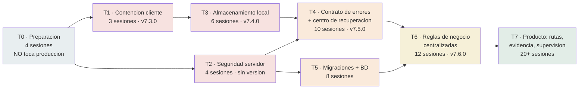

# Plan de implementación — corrección de los 38 hallazgos

**Documento hermano de:** `AUDITORIA_VISIBILITY_2026-09-03.md`
**Fecha:** 03-09-2026
**Cobertura:** los 38 hallazgos (V-01 … V-38). Ninguno queda fuera; los que se posponen figuran con la tanda en que entran y por qué.

---

## 0 · Cómo está armado este plan

### Tres reglas que gobiernan todo

**1. Se despliega por tandas, no por hallazgos sueltos.** Cada tanda es **un** despliegue con su propia versión de assets, su lista de verificación y su forma de revertir. Subir un arreglo suelto en esta app cuesta casi lo mismo que subir ocho, porque el trabajo caro no es el cambio: es la verificación manual y la coordinación del service worker.

**2. Ninguna tanda depende de una migración de base de datos que no esté aplicada.** El código que necesite una columna nueva se protege con `SHOW COLUMNS` (patrón `table_has_col()`, ya usado en `procesar_gestion_pruebas.php:89`) hasta que la migración esté confirmada en producción. Esto no es teórico: hoy nadie sabe con certeza qué migraciones corrieron.

**3. El orden lo manda el riesgo de pérdida de datos, no la dificultad.** Primero lo que hoy pierde información, después lo que la expone, después lo que la hace lenta o difícil de mantener.

### Restricciones reales del entorno, y qué hace el plan con cada una

| Restricción | Consecuencia para el plan |
|---|---|
| No hay PHP CLI ni MySQL en el entorno de desarrollo | Todo cambio PHP se verifica **por inspección + navegador contra el servidor**. La Tanda 0 monta el único arnés automatizable que existe hoy: Node sobre las funciones JS puras |
| No hay suite de pruebas ni CI | Cada ficha de tarea trae su **verificación manual explícita**. Sin eso, "listo" no significa nada |
| El service worker sirve `cacheFirst` para `/visibility2/app` | **Toda tanda que toque JS o CSS sube las tres versiones a la vez**: `$assetVer` en `index_pruebas.php:73`, `VERSION` en `sw.js:2`, `SW_VERSION` en `v2_cache.js:3`. Hoy las tres están en `v7.2.2` |
| Migraciones manuales, sin runner ni tabla de control | La numeración **ya se rompió**: existen dos `26_`, dos `27_`, y falta el `24_`. La Tanda 5 arregla esto antes de agregar una sola migración más. Las nuevas empiezan en `28_` |
| Convención `_pruebas` | Un cambio en la gestión toca `gestionarPruebas.php` **y** hay que decidir explícitamente si toca `gestionar.php` (viejo, todavía vivo). Cada ficha lo dice |
| `portal2/` es una copia bifurcada | **Fuera de alcance de este plan.** Si sigue en producción, requiere su propia pasada. Confirmar antes de empezar |
| Existe una copia obsoleta en `c:\Users\Diego\visibility2_\visibility2_\` | No se toca. El árbol vivo es `Desktop\Nueva carpeta\visibility2_` |

### Unidad de esfuerzo

**Sesión = medio día de trabajo enfocado de una persona** (≈4 h). Los totales asumen un desarrollador. Con dos personas, las tandas 1–3 se pueden paralelizar (una toma cliente, otra servidor); de la 4 en adelante hay dependencias que obligan a serializar.

---

## 1 · Secuencia de tandas



| Tanda | Qué cierra | Sesiones | Versión | Migración |
|---|---|---|---|---|
| **T0** Preparación | Nada en producción; habilita todo lo demás | 4 | — | — |
| **T1** Contención cliente | V-04, V-05, V-13, V-38 + contador | 3 | v7.3.0 | No |
| **T2** Seguridad servidor | V-01, V-07, V-14, V-25, V-26, V-22 | 4 | — | No |
| **T3** Almacenamiento local | V-03, V-06 | 6 | v7.4.0 | No |
| **T4** Contrato + recuperación | V-02, V-12, V-36, V-35 (parcial) | 10 | v7.5.0 | Sí (28) |
| **T5** Migraciones + BD | V-31, V-16, V-20, V-11, V-17, V-24, V-09 | 8 | — | Sí (29-31) |
| **T6** Reglas centralizadas | V-30, V-18, V-21, V-23, V-27, V-29, V-33, V-34, V-37, V-10 | 12 | v7.6.0 | Sí (32) |
| **T7** Producto | V-08, V-19, V-28, V-32, V-35 (completo) | 20+ | v8.0.0 | Sí |

**Total hasta T6 (sistema estabilizado): ≈47 sesiones ≈ 24 días de trabajo de una persona.**

---

## 2 · Tanda 0 — Preparación

*No toca producción. Sin esto, las tandas siguientes no son verificables.*

### T0-1 · Respaldo verificado y ventana de reversión · 1 sesión

Antes de tocar nada: respaldo completo de base de datos **restaurado en un entorno de prueba y verificado**, no sólo generado. Un dump de 1,7 GB que nadie restauró nunca no es un respaldo, es un archivo.

Copia del árbol de producción (`app/`, `portal/`, `lib_*.php`) con fecha, fuera de OneDrive.

**Terminado cuando:** existe un entorno donde se puede reproducir un bug de producción, y una copia del código a la que se puede volver en minutos.

---

### T0-2 · Inventario del esquema real · 1 sesión

Hoy nadie puede afirmar qué migraciones están aplicadas. Antes de agregar una más, hay que saber dónde estamos.

Contra producción, en modo lectura:

```sql
-- 1. Qué columnas de las migraciones "pendientes" ya existen
SHOW COLUMNS FROM fotoVisita     LIKE 'content_sha256';   -- scripts 12-15
SHOW COLUMNS FROM fotoVisita     LIKE 'phash';
SHOW COLUMNS FROM form_questions LIKE 'id_cadena';        -- script 17
SHOW COLUMNS FROM usuario        LIKE 'puede_adelantar_ruta'; -- script 21
SHOW TABLES LIKE 'foto_duplicada_log';                    -- script 12-15
SHOW TABLES LIKE 'pf_totem_%';                            -- script 22

-- 2. Magnitud real de los huérfanos (alimenta T5)
SELECT COUNT(*) FROM visita WHERE fecha_fin IS NULL AND fecha_inicio < NOW() - INTERVAL 1 DAY;
SELECT COUNT(*) FROM fotoVisita fv LEFT JOIN visita v ON v.id = fv.visita_id WHERE v.id IS NULL;
SELECT COUNT(*) FROM formularioQuestion fq LEFT JOIN formulario f ON f.id = fq.id_formulario WHERE f.id IS NULL;
SELECT COUNT(*) FROM formularioQuestion fq LEFT JOIN local l ON l.id = fq.id_local WHERE l.id IS NULL;
SELECT COUNT(*) FROM form_question_responses r LEFT JOIN form_questions q ON q.id = r.id_form_question WHERE q.id IS NULL;

-- 3. Índices realmente sin uso (necesita performance_schema activo)
SELECT * FROM sys.schema_unused_indexes  WHERE object_schema = DATABASE();
SELECT * FROM sys.schema_redundant_indexes WHERE table_schema = DATABASE();
```

**Terminado cuando:** existe una planilla con el estado real de cada migración de `scripts/` y los conteos de huérfanos. **Esos conteos deciden si V-17 (claves foráneas) es una tarde o una semana.**

> Nota del dump: el dump auditado ya tiene `content_sha256`, `phash`, `foto_duplicada_log`, `form_questions.id_cadena` y `usuario.puede_adelantar_ruta`. O sea, las migraciones 12–15, 17 y 21 **probablemente ya corrieron** y la memoria del proyecto está desactualizada. Confirmar contra producción, no contra el dump.

---

### T0-3 · Arnés de verificación para JS puro · 2 sesiones

Es lo único automatizable sin montar infraestructura. Cubre exactamente las funciones donde un error se paga caro y no se ve.

```
app/tests/
  run.mjs                 # node --test app/tests/*.test.mjs
  route_planner.test.mjs  # nearestNeighbor, twoOpt, chunkPoints,
                          # buildGoogleMapsExportChunks, routeStateHash
  queue_logic.test.mjs    # classifyFailure, isLogicalSuccess
  package.json            # { "type": "module", "scripts": { "test": "node --test app/tests" } }
```

`route_planner.js` es un IIFE que asigna a `window.RoutePlanner`. Para cargarlo desde Node sin tocar el archivo:

```js
// app/tests/_load.mjs — carga un IIFE de la app en un window falso
import { readFileSync } from 'node:fs';
import vm from 'node:vm';

export function loadGlobal(rutaRelativa) {
  const src = readFileSync(new URL(rutaRelativa, import.meta.url), 'utf8');
  const win = {};
  const ctx = vm.createContext({ window: win, console, Math, Date, JSON, Number });
  vm.runInContext(src, ctx);
  return win;
}
```

**Casos mínimos que deben existir** (cada uno corresponde a un hallazgo o a una regla que no se puede romper):

| Prueba | Protege |
|---|---|
| `twoOpt` mejora una ruta con cruce y **no** cierra el ciclo | Que nadie vuelva a introducir el 2-opt cíclico |
| Las botillerías salen **ordenadas** al final | V-13 — es la prueba que hace fallar el código actual |
| `buildGoogleMapsExportChunks` no pierde ninguna parada y encadena destino→origen | El export por bloques |
| `chunkPoints` respeta `SAFE_CHUNK_WAYPOINTS` | El límite de la API |
| `routeStateHash` cambia al moverse >50 m y no cambia al moverse 10 m | El recálculo por GPS |
| `classifyFailure` con 409 **sin** `error_code` → `retryable:false, success:false` | V-12 — falla con el código actual |
| `classifyFailure` con 500 → retryable | El contrato de reintentos |
| `isLogicalSuccess` rechaza `{}`, `{ok:false}`, `{status:'error'}` | La validación funcional |

**Terminado cuando:** `npm test` corre en verde salvo las dos pruebas que documentan V-13 y V-12 — que quedan **en rojo a propósito** hasta que las tandas 1 y 4 las arreglen. Empezar con las pruebas en rojo es lo que convierte el plan en verificable.

---

### T0-4 · Protocolo de despliegue escrito · sin costo adicional

Una sola página, pegada en el repo como `DESPLIEGUE.md`, con la lista de la sección 9 de este documento. Sin esto, la disciplina de las tres versiones se pierde a la tercera tanda.

---

## 3 · Tanda 1 — Contención en el cliente

**Versión: v7.3.0 · 3 sesiones · sin migración · reversión: volver a v7.2.2 y subir los 3 archivos anteriores**

Los cambios más baratos y de mayor efecto del plan. Todos son de cliente, todos entran en un despliegue.

---

### T1-1 · El contador de pendientes debe incluir los fallidos · 0,5 sesión

**Cierra:** el peor punto de ansiedad del producto (no tiene ID de hallazgo porque es un defecto de presentación, no de lógica).

**Archivo:** `app/index_pruebas.php`, función `updateQueuePanel`.

`Queue.getStatus()` **ya devuelve `error`** correctamente (`offline-queue.js:1729-1745`, suma `error` + `failed_permanent`). El bug es sólo de pintado: la píldora dice `'Cola: ' + pending` e ignora el resto.

```js
// Antes
if (countEl) countEl.textContent = 'Cola: ' + pending;

// Después
const sinResolver = pending + running + error;
if (countEl) {
  countEl.textContent = error > 0
    ? `Cola: ${sinResolver} (${error} con error)`
    : `Cola: ${sinResolver}`;
  countEl.classList.toggle('queue-has-error', error > 0);
}
```

Y una regla CSS que pinte `.queue-has-error` en rojo, para que se vea sin leer.

**Verificación:** en la consola del navegador, forzar un job a error:
```js
const [j] = await AppDB.listByStatus('queued');
await AppDB.update(j.id, { status:'error', finishedAt: Date.now() });
window.dispatchEvent(new Event('queue:update'));
```
La píldora debe decir "(1 con error)" en rojo.

**Reversión:** una línea.

---

### T1-2 · `cleanup` deja de borrar trabajo fallido · 0,5 sesión

**Cierra:** V-04.

**Archivo:** `app/assets/js/db.js:326`.

```js
// Antes
const isFinal = ['success','done','error','failed_permanent','canceled'].includes(job.status);

// Después
// 'error' y 'failed_permanent' NO son "finalizados": son trabajo del ejecutor que
// nunca llegó al servidor. Sólo se descartan desde el centro de recuperación,
// con confirmación explícita y tras exportar el diagnóstico.
const isFinal = ['success','done','canceled'].includes(job.status);
```

Y en `index_pruebas.php`, el texto del `confirm` del botón Limpiar pasa a decir la verdad:
> "Se borrará el historial de envíos **completados**. Las gestiones con error se conservan."

**Verificación:** dejar un job en `error`, tocar "Limpiar", confirmar. El job sigue ahí y el contador de T1-1 lo sigue mostrando.

**Reversión:** una línea. **Sin riesgo:** el cambio sólo deja de borrar.

---

### T1-3 · Almacenamiento persistente · 1 sesión

**Cierra:** V-05.

**Archivo:** `app/assets/js/bootstrap_index_cache.js` (junto al listener de `db:quota_exceeded`, línea 302).

```js
/**
 * Pide al navegador que el almacenamiento del origen sea PERSISTENTE.
 * Sin esto, iOS borra los datos del sitio a los 7 días sin uso y Chrome
 * los desaloja bajo presión de espacio: las fotos en cola son borrables
 * por el sistema operativo sin aviso. Se pide una sola vez por dispositivo;
 * el navegador recuerda la respuesta.
 */
async function asegurarAlmacenamientoPersistente(){
  if (!navigator.storage || !navigator.storage.persist) return null;
  try {
    if (await navigator.storage.persisted()) return true;
    const ok = await navigator.storage.persist();
    if (!ok && typeof window.mostrarToast === 'function') {
      window.mostrarToast(
        'Este teléfono puede borrar tus fotos pendientes si se queda sin espacio. Sincroniza apenas tengas señal.',
        'warn', 9000
      );
    }
    return ok;
  } catch (_) { return null; }
}
window.addEventListener('load', asegurarAlmacenamientoPersistente);
```

Además: incluir el resultado en el payload de diagnóstico de `journal_db.js` (junto a `storage_estimate`, línea 618), para saber en soporte si un teléfono está protegido o no.

**Verificación:** en el navegador, `await navigator.storage.persisted()` devuelve `true` tras cargar el index. En Chrome Android se concede si la PWA está instalada; en Safari iOS depende del uso. **Registrar el resultado real en 3 teléfonos distintos** — la respuesta varía por navegador y esa variación es información operativa.

**Reversión:** quitar la llamada. No hay estado que deshacer.

---

### T1-4 · Ordenar las botillerías · 0,5 sesión

**Cierra:** V-13. **Hace pasar** la prueba que T0-3 dejó en rojo.

**Archivo:** `app/assets/js/route_planner.js:186-190`.

```js
// Antes
let ordNormales = nearestNeighbor(origin, normales);
ordNormales     = twoOpt(origin, ordNormales);
const ordered   = [...ordNormales, ...botillerias];

// Después
let ordNormales = nearestNeighbor(origin, normales);
ordNormales     = twoOpt(origin, ordNormales);

// Las botillerías van al final por su horario de apertura, pero ENTRE ELLAS
// también se ordenan: antes se concatenaban en el orden en que venían del SQL,
// así que en una jornada con muchas botillerías el tramo final iba sin optimizar.
// El origen de ese tramo es la última parada normal (o el ejecutor si no hay).
let ordBotillerias = [];
if (botillerias.length) {
  const origenTramo = ordNormales.length ? ordNormales[ordNormales.length - 1] : origin;
  ordBotillerias = twoOpt(origenTramo, nearestNeighbor(origenTramo, botillerias));
}
const ordered = [...ordNormales, ...ordBotillerias];
```

**Verificación:** la prueba de T0-3 pasa a verde. En el navegador, con una fecha que tenga ≥4 botillerías antes de las 13:00, comparar la distancia total antes y después. **Anotar la diferencia:** es el único número de este plan que se puede presentar como ahorro concreto.

**Reversión:** revertir el bloque. Sin efectos persistentes.

---

### T1-5 · Techo de imagen razonable en el servidor · 0,5 sesión

**Cierra:** V-38. *(Va en esta tanda aunque sea servidor porque es una constante y no requiere coordinación.)*

**Archivos:** `app/procesar_gestion_pruebas.php:264,282` y el mismo bloque en `procesar_gestion.php:~123`.

```php
$maxFileSize = 12 * 1024 * 1024;  // antes 50MB
$maxWidth = 4000; $maxHeight = 4000;  // antes 8000x8000
```

12 MB y 4000 px están muy por encima de lo que envía el cliente comprimido (1 MB / 1280 px) y por encima de una foto de cámara sin comprimir en el peor caso offline. Imagick decodificando 8000×8000 pide ~256 MB de RAM; 4000×4000 pide ~64 MB.

El mensaje de rechazo tiene que decir qué hacer, no sólo que falló:
```php
throw new Exception('La imagen es demasiado grande (máx 12 MB). Vuelve a tomarla con la app abierta.');
```

**Verificación:** subir una imagen de 20 MB → rechazo con mensaje legible, sin 500 ni página en blanco.

---

**Cierre de la Tanda 1:** subir los tres archivos de versión a `v7.3.0`, seguir el protocolo de la sección 9, y verificar en un teléfono real que el service worker sirvió los archivos nuevos (`caches.keys()` debe mostrar `static-v7.3.0`).

---

## 4 · Tanda 2 — Seguridad en el servidor

**4 sesiones · sin cambio de versión de assets** (salvo T2-1, que toca `usuario.js`) **· reversión: restaurar los archivos anteriores**

---

### T2-1 · Retirar `ws.php` · 1,5 sesiones

**Cierra:** V-01, el hallazgo más grave del informe.

**El archivo tiene 118 KB, 65 `query()`, 0 `prepare()` — y sólo se usa para dos cosas.** `usuario.js:248` y `usuario.js:273` lo llaman para activar y desactivar usuarios, por GET, con `idUsuario` en la query string. Todo lo demás es código muerto que apunta incluso a tablas que ya no existen (`loc_region`, `loc_comuna`, `zonal`, `elementos`, `entidades`).

**Paso 1 — endpoint de reemplazo.** `app/api/usuario_estado.php`, ~40 líneas:

```php
<?php
declare(strict_types=1);
require_once __DIR__ . '/../lib/api_helpers.php';
require_once __DIR__ . '/../con_.php';

require_post_method();                 // ya existe en api_helpers.php
require_auth();
require_csrf();

// Sólo perfiles administrativos cambian el estado de una cuenta.
$perfil = strtolower($_SESSION['perfil_nombre'] ?? '');
if (!in_array($perfil, ['administrador', 'editor'], true)) {
    api_response_error_v2(403, 'No tienes permisos para cambiar el estado de un usuario.');
}

$idUsuario = post_int_v2('id_usuario', 0);
$activo    = post_int_v2('activo', -1);
if ($idUsuario <= 0 || !in_array($activo, [0, 1], true)) {
    api_response_error_v2(422, 'Parámetros inválidos.');
}

// Un usuario no puede desactivarse a sí mismo: se quedaría sin acceso al portal.
if ($idUsuario === (int)$_SESSION['usuario_id']) {
    api_response_error_v2(422, 'No puedes cambiar el estado de tu propia cuenta.');
}

// Alcance por empresa: nadie toca cuentas de otra empresa.
$stmt = $conn->prepare('UPDATE usuario SET activo = ? WHERE id = ? AND id_empresa = ?');
$stmt->bind_param('iii', $activo, $idUsuario, $_SESSION['empresa_id']);
if (!$stmt->execute()) {
    api_response_error_v2(500, 'No se pudo actualizar el usuario.', [], $conn, 'usuario_estado');
}
$afectados = $stmt->affected_rows;
$stmt->close();

if ($afectados === 0) {
    api_response_error_v2(404, 'El usuario no existe o no pertenece a tu empresa.');
}

// Desactivar una cuenta debe cortar sus sesiones abiertas, no sólo marcar la fila.
if ($activo === 0) {
    if ($rv = $conn->prepare('UPDATE user_sessions SET revoked_at = NOW() WHERE user_id = ? AND revoked_at IS NULL')) {
        $rv->bind_param('i', $idUsuario); $rv->execute(); $rv->close();
    }
}

api_response_ok(['id_usuario' => $idUsuario, 'activo' => $activo]);
```

Nótese que el endpoint nuevo **arregla tres cosas que `ws.php` no hacía**: GET→POST, CSRF, y revocar las sesiones del usuario desactivado.

**Paso 2 — actualizar `usuario.js`** (las dos llamadas, a POST con `csrf_token`).

**Paso 3 — borrar `app/ws.php`** del repo y del servidor.

**Verificación:**
1. Activar y desactivar un usuario desde el portal → funciona.
2. `GET /visibility2/app/ws.php?ws=activarUsuario&idUsuario=1` → **404**.
3. Un usuario desactivado con sesión abierta queda fuera en su siguiente request.
4. `grep -rn "ws\.php" app/ portal/` → sin resultados.

**Reversión:** restaurar `ws.php` y el `usuario.js` anterior. **Antes de borrar, guardar una copia fuera del árbol servido** por si aparece un consumidor no detectado (por ejemplo, un integrador externo llamándolo directo). Si a las dos semanas el log de acceso no muestra peticiones, se descarta la copia.

---

### T2-2 · Cerrar el IDOR de `visita_id` · 1 sesión

**Cierra:** V-07.

**Archivo:** `app/procesar_gestion_pruebas.php:401-410`. Mismo patrón en `procesar_gestion.php` y en `upload_material_foto_pruebas.php` / `procesar_pregunta_foto_pruebas.php` si aceptan `visita_id` del POST — **verificar los cuatro**.

```php
$visita_id = 0;

// El visita_id que manda el cliente NO se acepta a ciegas: se verifica que la
// visita sea de este usuario, esta campaña y este local. Sin esta comprobación,
// un ejecutor podía adjuntar fotos y respuestas a la visita de otro, y cerrarla.
if (isset($_POST['visita_id']) && intval($_POST['visita_id']) > 0) {
  $cand = intval($_POST['visita_id']);
  if ($q = $conn->prepare(
      "SELECT id FROM visita
        WHERE id=? AND id_usuario=? AND id_formulario=? AND id_local=? LIMIT 1")) {
    $q->bind_param('iiii', $cand, $usuario_id, $idCampana, $idLocal);
    $q->execute(); $q->bind_result($ok_id);
    if ($q->fetch()) { $visita_id = (int)$ok_id; }
    $q->close();
  }
  if ($visita_id <= 0) {
    // No se cae: se sigue por client_guid, que es el camino seguro del modo offline.
    error_log("[seguridad] visita_id ajeno rechazado: uid=$usuario_id visita=$cand");
  }
}

if ($visita_id <= 0 && $client_guid !== '') {
  // ... resolución por client_guid, sin cambios ...
}
```

**Decisión de diseño:** no se devuelve 403 de inmediato. Un `visita_id` inválido puede venir de un mapping local desactualizado en un cliente offline, no de un ataque. Se ignora, se registra, y se resuelve por `client_guid`, que ya valida propiedad. Sólo si tampoco hay `client_guid` se devuelve el 422 que ya existe.

**Verificación:** con dos cuentas de prueba, A crea una visita y anota su id; B intenta enviar una gestión con ese `visita_id`. Resultado: la gestión de B crea o usa **su propia** visita, y la de A no cambia (`fecha_fin` sigue nula, sin fotos nuevas).

---

### T2-3 · Cerrar la vía de subida de extensión arbitraria · 1 sesión

**Cierra:** V-14.

**Archivo:** `app/procesar_gestion_pruebas.php:335-350` y el mismo bloque en `procesar_gestion.php`.

```php
// La extensión NO se toma del nombre que envía el cliente. Si la conversión a
// WebP falla, sólo se conservan formatos de imagen conocidos; cualquier otra cosa
// se rechaza en vez de escribirse con su extensión original en un directorio servido.
const EXT_IMAGEN_PERMITIDAS = ['jpg','jpeg','png','gif','webp'];

if (!convertirAWebP($tmp, $destinoWebp, 80)) {
    $extOrig = strtolower(pathinfo($origName, PATHINFO_EXTENSION) ?: '');
    if (!in_array($extOrig, EXT_IMAGEN_PERMITIDAS, true)) {
        throw new Exception("Formato de imagen no admitido ($prefix).");
    }
    $destinoOrig = $baseDir . $baseName . '.' . $extOrig;
    // ... resto igual ...
}
```

**Y en el servidor**, `app/uploads/.htaccess` (versionar el archivo, con la excepción correspondiente en `.gitignore`, como ya se hizo con `cache_editor/.htaccess`):

```apache
# uploads/ guarda evidencia fotográfica. Nada de acá se ejecuta jamás.
php_flag engine off
<IfModule mod_headers.c>
  Header set X-Content-Type-Options "nosniff"
</IfModule>
<FilesMatch "\.(php|phtml|php[0-9]|phar|cgi|pl|py|sh|htaccess)$">
  Require all denied
</FilesMatch>
```

**Verificación:** subir un archivo llamado `prueba.phtml` con contenido de imagen válido pero no convertible → rechazado con mensaje. Y colocar a mano un `test.php` con `<?php echo 1;` en `uploads/` y pedirlo por URL: debe descargarse como texto o dar 403, **nunca** imprimir `1`. Borrarlo después.

> Este es el hallazgo cuya gravedad depende de la configuración del servidor. La prueba de arriba es la que la resuelve: si el `.php` se ejecuta, V-14 era crítico; si no, era preventivo.

---

### T2-4 · Tres arreglos menores · 0,5 sesión

| Cambio | Archivo | Cierra |
|---|---|---|
| Los orígenes `http://localhost:*` de CORS sólo cuando `getenv('V2_TEST_MODE')==='1'` | `_session_guard.php:22-24`, `api/mobile/_auth_mobile.php:15-16` | V-25 |
| `error_log` al `.gitignore` + `git rm --cached app/error_log` | `.gitignore` | V-26 |
| Endpoint de idempotencia distinto: `'procesar_gestion_v2'` | `procesar_gestion_pruebas.php:84` | V-22 |

El último tiene un detalle: cambiar la clave de endpoint hace que **las claves de idempotencia en vuelo dejen de coincidir**. Un job encolado antes del despliegue se reejecutará en vez de replicar su respuesta. Por eso va en esta tanda y no en la T4: hay que hacerlo **cuando la cola de los ejecutores esté vacía**, es decir, al inicio de la jornada o un fin de semana.

---

## 5 · Tanda 3 — Almacenamiento local

**Versión: v7.4.0 · 6 sesiones · sin migración**

La tanda más delicada del plan del lado cliente: toca datos que ya existen en los teléfonos de los ejecutores. **Requiere que T1 esté desplegada y estable al menos una semana**, porque el contador honesto de T1-1 es lo que permite ver si algo sale mal.

---

### T3-1 · Librerías de foto locales · 2 sesiones

**Cierra:** V-06.

**Paso 1 — descargar con versión fija** a `app/assets/vendor/`:

| Archivo | Origen | Versión a fijar |
|---|---|---|
| `browser-image-compression.js` | jsdelivr | **2.0.2** (hoy dice `@latest`: no se sabe cuál corre) |
| `heic2any.min.js` | jsdelivr | 0.0.4 (la que ya está fijada) |
| `exifr.umd.js` | jsdelivr | 7.1.3 |

**Antes de fijar 2.0.2, comprobar cuál está sirviendo `@latest` hoy** y usar esa, para no cambiar el comportamiento de compresión y el arreglo de offline en el mismo despliegue.

**Paso 2 — cambiar las etiquetas** en `gestionarPruebas.php:452-454`, `gestionar.php:218-219`, `gestionarIW.php:485` a `assets/vendor/...?v=<?php echo $assetVer; ?>`.

**Paso 3 — agregarlas al service worker**, `sw.js:9-24`:
```js
`${APP_SCOPE}/assets/vendor/browser-image-compression.js`,
`${APP_SCOPE}/assets/vendor/heic2any.min.js`,
`${APP_SCOPE}/assets/vendor/exifr.umd.js`,
```

**Paso 4 — sacar `cdn.jsdelivr.net` del CSP** en `lib/security_headers.php:18`. Ojo: `login.php:266` y `login_pruebas.php:247` cargan `sweetalert2@11` del mismo CDN. **Bajar también sweetalert2 a `vendor/`** en esta tanda, o el login se rompe al cerrar el CSP. Es el error más fácil de cometer acá.

**Verificación (la prueba que define esta tanda):**
1. Cargar la app con red, para poblar el caché.
2. **Modo avión.**
3. Abrir una gestión, sacar una foto de ≥5 MB.
4. En consola: la foto encolada pesa **< 1,5 MB** y `meta.exif_datetime` **no está vacío**.
5. Pestaña Red: **cero** peticiones a `cdn.jsdelivr.net`.
6. Volver a tener red, drenar, y confirmar en el portal que la foto llegó con sus metadatos.
7. Cerrar sesión y volver a entrar: el login funciona (el CSP no rompió sweetalert2).

**Reversión:** volver a las etiquetas de CDN y al CSP anterior. Las fotos ya encoladas no se ven afectadas.

---

### T3-2 · Purga y aislamiento por usuario · 4 sesiones

**Cierra:** V-03.

Tres cambios que **van juntos o no van**:

**a) Sellar cada trabajo con su dueño.** En `Queue.enqueue` (`offline-queue.js:1508`), agregar `task.owner_id = window.__USUARIO_ID` (ya expuesto como `__GESTIONAR_PRECACHE_USER` en `index_pruebas.php`). Y en `drain` (línea 1246), descartar lo ajeno:

```js
// Un trabajo encolado por otro usuario en este mismo teléfono no se envía con la
// sesión actual: el servidor lo rechazaría por permisos y la clave de idempotencia
// quedaría quemada. Se deja marcado para que el centro de recuperación lo muestre.
if (t.owner_id && window.__USUARIO_ID && Number(t.owner_id) !== Number(window.__USUARIO_ID)) {
  await AppDB.update(t.id, {
    status: 'error',
    finishedAt: now,
    lastError: buildLastError({
      code: 'OWNER_MISMATCH',
      message: 'Esta gestión la creó otro usuario en este dispositivo.',
      url: t.url
    })
  });
  continue;
}
```

Los trabajos que ya están en los teléfonos no tienen `owner_id`; la condición los deja pasar, que es el comportamiento actual. Correcto: no se puede adivinar de quién son.

**b) No dejar cerrar sesión con trabajo sin enviar.** En `index_pruebas.php`, interceptar el enlace de "Cerrar sesión":

```js
document.querySelector('a[href="logout.php"]')?.addEventListener('click', async (e) => {
  if (!window.Queue) return;
  const st = await Queue.getStatus();
  const sinEnviar = st.pending + st.running + st.error;
  if (sinEnviar === 0) return;
  e.preventDefault();
  // Se avisa con el número exacto: "tienes pendientes" no mueve a nadie a buscar señal.
  mostrarToast(
    `Tienes ${sinEnviar} gestión(es) sin enviar. Si cierras sesión ahora, se pierden.`,
    'warn', 15000,
    [
      { label: 'Intentar enviar', cls: 'btn-info',    fn: () => Queue.flushNow() },
      { label: 'Exportar',        cls: 'btn-default', fn: () => window.Journal?.exportarDiagnostico?.() },
      { label: 'Cerrar igual',    cls: 'btn-danger',  fn: () => { location.href = 'logout.php?forzar=1'; } }
    ]
  );
});
```

**c) Purgar de verdad en `logout.php`.** Ampliar el script de la página (líneas 101-115), que hoy sólo habla con el service worker:

```js
// El SW ya se limpia arriba. Falta IndexedDB: sin esto, la cola, las fotos, los
// borradores y la agenda del usuario que sale quedan disponibles para el que entra
// en el mismo teléfono.
const BASES = ['v2_offline', 'visibility2-v2', 'v2_journal', 'v2_queue_mappings'];
await Promise.all(BASES.map(nombre => new Promise(resolve => {
  try {
    const req = indexedDB.deleteDatabase(nombre);
    req.onsuccess = req.onerror = req.onblocked = () => resolve();
    setTimeout(resolve, 1500);   // otra pestaña abierta bloquearía el borrado
  } catch (_) { resolve(); }
})));

try {
  Object.keys(localStorage)
    .filter(k => k.startsWith('v2_'))
    .forEach(k => localStorage.removeItem(k));
} catch (_) {}
```

**Confirmar los nombres reales de las bases antes de escribir la lista.** En consola: `await indexedDB.databases()`. Los dos primeros están confirmados en el código (`db.js:3`, `v2_cache.js:4`); los de journal y mappings hay que leerlos de sus archivos.

**Verificación:**
1. Usuario A encola 3 gestiones sin red. Intenta cerrar sesión → aparece el aviso con "3".
2. "Cerrar igual" → tras el logout, `await indexedDB.databases()` devuelve lista vacía y no queda ninguna clave `v2_` en localStorage.
3. Entra el usuario B: la app arranca limpia, sin agenda ni cola del anterior.
4. Con A todavía con sesión: encolar como A, y con la consola simular `window.__USUARIO_ID = 999` y drenar → el job va a `error` con `OWNER_MISMATCH` y **no** se envía.

**Reversión:** el punto (c) es el único irreversible en su efecto (borra datos locales). Por eso el punto (b) es requisito: sin el aviso, la purga destruye trabajo. **No desplegar (c) sin (b).**

---

## 6 · Tanda 4 — Contrato de errores y centro de recuperación

**Versión: v7.5.0 · 10 sesiones · migración `28_` · el corazón del plan**

Buena noticia encontrada al preparar este plan: **el contrato ya existe**. `lib/api_helpers.php` tiene `api_response_ok()` (línea 259) y `api_response_error_v2()` (línea 288), que ya calcula `retryable` según el código HTTP, mapea `error_code`, genera `error_id` y lo registra en base de datos. `procesar_gestion_pruebas.php` simplemente **no lo usa**: tiene su propio `respond_err()`.

Esto convierte la tarea de "diseñar un contrato" en "adoptar el que ya está escrito".

---

### T4-1 · Distinguir rechazo de negocio de fallo de infraestructura · 3 sesiones

**Cierra:** V-02, el hallazgo con más impacto en pérdida de datos.

**El problema exacto:** `procesar_gestion_pruebas.php:1001` guarda el 500 como respuesta **definitiva** de la clave de idempotencia. Todo reintento la reproduce sin ejecutar nada.

**La distinción que hay que introducir:**

| Tipo | Ejemplo | HTTP | Idempotencia | Cliente |
|---|---|---|---|---|
| **Rechazo determinista** | valor > propuesto, motivo faltante, foto duplicada | 422 / 409 | **Se persiste** (misma entrada → mismo rechazo siempre) | No reintenta; va a la bandeja |
| **Fallo de infraestructura** | deadlock, lock timeout, disco lleno | 500 | **`idempo_mark_failed()`** | Reintenta de verdad |
| **Conflicto de estado** | local reasignado, campaña cerrada | 409 con `error_code` | Se persiste | Va a la bandeja de conflictos |

**Implementación.** Una clase de excepción para lo determinista:

```php
/**
 * Rechazo de negocio: la misma entrada siempre produce el mismo rechazo, así que
 * SÍ corresponde persistirlo como respuesta idempotente. Reintentarlo no sirve.
 * Todo lo demás (Exception a secas) se trata como fallo transitorio.
 */
class GestionRechazadaException extends Exception {
  public function __construct(string $msg, public string $codigo = 'VALIDATION', public int $http = 422) {
    parent::__construct($msg);
  }
}
class GestionConflictoException extends GestionRechazadaException {
  public function __construct(string $msg, string $codigo) { parent::__construct($msg, $codigo, 409); }
}
```

Las validaciones existentes pasan a lanzarla:

```php
// Antes
if ($valorNum > intval($rowV['valor_propuesto'])) { throw new Exception("Valor ($valorNum) excede..."); }
if (!$rowV) { throw new Exception("No tienes permisos sobre el material (ID=$idFQ)."); }

// Después
if ($valorNum > intval($rowV['valor_propuesto'])) {
  throw new GestionRechazadaException("El valor $valorNum supera lo comprometido ({$rowV['valor_propuesto']}).", 'VALOR_EXCEDE');
}
if (!$rowV) {
  throw new GestionConflictoException('Este material ya no está asignado a ti. Avisa a tu supervisor.', 'ASSIGNMENT_CHANGED');
}
```

Y los dos `catch` finales reemplazan el bloque de la línea 972:

```php
} catch (GestionRechazadaException $e) {
  $conn->rollback();
  limpiarImagenesSubidas($imagenes);
  update_gestion_draft($conn, $client_guid, 'failed', ['error_code' => $e->codigo, 'error_message' => $e->getMessage()]);
  // Determinista: se persiste. Un reintento con la misma entrada daría lo mismo.
  if (idempo_get_key()) {
    idempo_store_and_reply($conn, 'procesar_gestion_v2', $e->http, [
      'ok' => false, 'status' => 'error', 'error_code' => $e->codigo,
      'message' => $e->getMessage(), 'retryable' => false,
    ]);
  }
  api_response_error_v2($e->http, $e->getMessage(), ['error_code' => $e->codigo, 'retryable' => false], $conn, 'procesar_gestion');

} catch (Throwable $e) {
  $conn->rollback();
  limpiarImagenesSubidas($imagenes);
  update_gestion_draft($conn, $client_guid, 'failed', ['error_code' => 'TRANSACTION_FAILED', 'error_message' => $e->getMessage()]);
  // Transitorio: la clave se LIBERA para que el reintento vuelva a ejecutarse.
  // Persistirlo aquí (como hacía antes) convertía cualquier deadlock en pérdida definitiva.
  idempo_mark_failed($conn, 'procesar_gestion_v2', 'TRANSACTION_FAILED');
  api_response_error_v2(500, 'No se pudo guardar la gestión. Se reintentará solo.', [], $conn, 'procesar_gestion');
}
```

`api_response_error_v2` ya devuelve `retryable: true` para el 500 y `false` para el 422, y ya genera el `error_id`. No hay que escribirlo.

**Aplicar el mismo patrón** a los otros cuatro endpoints que hoy persisten errores como definitivos: `eliminar_material_foto_pruebas.php` (líneas 101, 119, 130, 195) y `eliminar_pregunta_foto_pruebas.php` (110, 130, 141, 211). El 409 de `procesar_pregunta_foto_pruebas.php:361` **se deja como está**: es el caso correcto de rechazo determinista.

**Verificación — la más importante del plan.** No se puede probar sin provocar un fallo transitorio. Método: en un entorno de prueba, agregar temporalmente al inicio de la transacción:
```php
if (getenv('V2_FORZAR_FALLO') === '1') { throw new RuntimeException('fallo simulado'); }
```
1. Con la variable activa, enviar una gestión → 500, y en `request_log` la fila queda en **`failed`**, no en `completed`.
2. Quitar la variable, reintentar con **la misma** clave desde la cola → **se guarda**.
3. Enviar una gestión con valor mayor al propuesto → 422, `retryable:false`, la fila queda `completed`, y el reintento devuelve el mismo 422 sin reejecutar.
4. Quitar el bloque de simulación antes de subir a producción. **Anotarlo en la lista de la sección 9.**

---

### T4-2 · El 409 sin código deja de ser éxito · 0,5 sesión

**Cierra:** V-12. **Hace pasar** la otra prueba en rojo de T0-3.

**Archivo:** `app/assets/js/offline-queue.js:895`.

```js
// Antes
return { code: 'DUPLICATE', retryable: false, success: true, retryConfig: RETRY_CONFIG['DUPLICATE'] };

// Después
// Un 409 sólo cuenta como éxito si el servidor lo dice explícitamente. Sin error_code
// no se puede saber si el registro quedó guardado, y darlo por bueno borraba el trabajo.
if (errorCode === 'ALREADY_EXISTS' || errorCode === 'DUPLICATE') {
  return { code: 'DUPLICATE', retryable: false, success: true, retryConfig: RETRY_CONFIG['DUPLICATE'] };
}
return { code: errorCode || 'CONFLICT', retryable: false, conflict: true };
```

Y en `drain`, los `conflict` van a un estado propio en vez de a `error`, para que el centro de recuperación los distinga:
```js
const status = failure.conflict ? 'conflict'
             : failure.blocked === 'auth' ? 'blocked_auth'
             : /* ... resto igual ... */;
```
Añadir `'conflict'` a los estados que cuenta `getStatus()` y que lista `listErrors()`.

---

### T4-3 · Centro de recuperación · 4 sesiones

**Cierra:** el callejón sin salida del estado `error`. Es lo que hace que T1-2 y T3-2 sean seguros.

Pantalla nueva, `app/recuperacion.php`, enlazada desde la píldora roja del contador de T1-1. Por cada trabajo en `error`, `failed_permanent` o `conflict`:

- **Qué era**, en el idioma del ejecutor: "Gestión de Local 4821 · Campaña Navidad · 3 fotos", no `procesar_gestion_pruebas.php`.
- **Cuándo** se creó y cuántos intentos lleva.
- **Por qué falló**, traducido. Un diccionario `error_code` → frase:
  | Código | Texto para el ejecutor |
  |---|---|
  | `ASSIGNMENT_CHANGED` | "Este local ya no está asignado a ti. Avisa a tu supervisor antes de reintentar." |
  | `VALOR_EXCEDE` | "La cantidad informada supera la comprometida. Corrige y vuelve a gestionar." |
  | `DUPLICATE_PHOTO` | "Esa foto ya se usó en otro local de esta campaña. Toma una nueva." |
  | `OWNER_MISMATCH` | "Esta gestión la creó otra persona en este teléfono." |
  | `MISSING_DEPENDENCY` | "Se perdió el vínculo con la visita. Hay que rehacer la gestión." |
  | `TRANSACTION_FAILED` | "El servidor tuvo un problema. Puedes reintentar." |
- **Tres acciones:** *Reintentar* (vuelve a `queued` con `attempts:0`), *Exportar para soporte* (reutiliza `journal_db.buildDiagnosticPayload`, que ya existe), *Descartar* — que **exige exportar primero** y escribe una entrada en la bitácora de que se descartó.

**Verificación:** un trabajo forzado a `error` aparece en la pantalla con texto legible; "Reintentar" lo devuelve a la cola y se envía; "Descartar" no está disponible hasta exportar.

---

### T4-4 · Idempotencia en los endpoints que no la tienen · 1,5 sesiones

**Cierra:** V-36.

Cuatro endpoints donde un reintento de la cola crea un duplicado: `actualizar_ubicacion.php`, `guardar_recepcion_materiales.php`, `api/solicitud_cambio_local.php`, `api/solicitud_cambio_vendedor.php`.

Los dos de solicitudes son los que más molestan al editor (revisa solicitudes duplicadas). `actualizar_ubicacion.php` es un UPSERT y es idempotente por naturaleza: **no necesita cambio**, sólo dejarlo anotado para que no vuelva a aparecer en una auditoría como falso positivo.

Para los otros tres: `idempo_claim_or_fail($conn, '<nombre>')` al inicio y `idempo_store_and_reply()` en la salida exitosa, con el patrón de T4-1 en los errores.

---

### T4-5 · Envío automático del resumen de bitácora · 1 sesión

**Cierra:** V-35 parcialmente (el resto va en T7).

`api/journal_server.php` ya existe. Falta que el cliente lo llame solo, en dos momentos: al recuperar conexión tras haber estado offline, y al drenar la cola por completo. Enviar sólo el **resumen del día** (contadores por estado + últimos errores), no la bitácora entera.

**Migración `28_journal_resumen.sql`:** tabla `journal_resumen_diario (user_id, ymd, pendientes, errores, subidas, ultimo_error_code, app_version, actualizado_at)` con `UNIQUE(user_id, ymd)`.

Con esto, la consulta "¿quién tiene trabajo sin subir?" pasa de imposible a una línea de SQL. Es el insumo del panel de la T7.

---

## 7 · Tanda 5 — Migraciones y base de datos

**8 sesiones · sin cambio de assets · requiere ventana de mantenimiento para algunos pasos**

---

### T5-1 · Runner de migraciones · 2 sesiones

**Cierra:** V-31. **Es requisito de todo lo demás en esta tanda.**

La evidencia de que hace falta está en el propio directorio: `scripts/` tiene **dos archivos `26_`, dos `27_`, y ningún `24_`**. La convención "el siguiente número gana" ya se rompió.

```
scripts/
  migrate.php          # aplica lo pendiente, en orden, y registra
  000_migrations.sql   # crea la tabla de control
```

```sql
CREATE TABLE IF NOT EXISTS schema_migrations (
  version     VARCHAR(100) NOT NULL PRIMARY KEY,  -- nombre del archivo
  checksum    CHAR(64)     NOT NULL,              -- sha256: detecta ediciones posteriores
  aplicado_at DATETIME     NOT NULL DEFAULT CURRENT_TIMESTAMP,
  aplicado_por VARCHAR(100) DEFAULT NULL,
  duracion_ms INT DEFAULT NULL
) ENGINE=InnoDB DEFAULT CHARSET=utf8mb4;
```

`migrate.php` (~120 líneas): lista `scripts/*.sql` ordenados, salta los ya registrados, avisa si el checksum de uno aplicado cambió, ejecuta el resto en orden dentro de una transacción por archivo cuando el DDL lo permite, y registra. Con `--dry-run` para ver qué haría.

**Primer uso — reconciliación.** Los scripts 12 a 27 ya corrieron (total o parcialmente). Registrarlos como aplicados **sin ejecutarlos**, con `migrate.php --marcar-aplicado`, usando el inventario de T0-2 como fuente de verdad. Resolver ahí mismo los números duplicados renombrando a `26a_`/`26b_` y dejando constancia.

**Terminado cuando:** `php scripts/migrate.php --dry-run` en producción dice "0 pendientes" y la tabla tiene una fila por cada script del directorio.

---

### T5-2 · Podar índices · 2 sesiones + ventana

**Cierra:** V-16.

**Paso 1, riesgo cero — duplicados exactos.** Estos tres pares son idénticos; eliminar uno de cada par no cambia ningún plan de ejecución:

```sql
ALTER TABLE request_log DROP INDEX uk_idempo;                    -- = uniq_req
ALTER TABLE material    DROP INDEX ux_material_nombre_division;  -- = ux_mat_nombre_div
ALTER TABLE visita      DROP INDEX uniq_visita_client_guid;      -- = uq_visita_client_guid
```

**Paso 2, riesgo bajo — prefijos redundantes.** Un índice cuya lista de columnas es prefijo exacto de otro no aporta nada:

```sql
ALTER TABLE form_question_responses
  DROP INDEX idx_fqr_q, DROP INDEX idx_fqr_formq,
  DROP INDEX idx_fqr_created, DROP INDEX idx_fqr_visita,
  DROP INDEX idx_fqr_user, DROP INDEX idx_fqr_local;

ALTER TABLE formularioQuestion
  DROP INDEX id_formulario, DROP INDEX idx_formularioQuestion_formulario,
  DROP INDEX idx_fq_formulario, DROP INDEX idx_fq_fecha, DROP INDEX idx_fq_pregunta;
```

**Paso 3, sólo con datos — los no usados.** Requiere `sys.schema_unused_indexes` con **al menos un mes** de estadísticas acumuladas (T0-2 arranca el reloj). Objetivo: bajar `form_question_responses` de 45 a ≤12 índices.

**Medir antes y después:** tiempo de inserción de un lote de 100 respuestas, y tamaño de la tabla con sus índices. Sin ese número, "está más rápido" es una impresión.

**Reversión:** guardar el `SHOW CREATE TABLE` de las tres tablas antes de empezar. Recrear un índice es un `ALTER` — lento en 9,2 M filas, pero seguro.

---

### T5-3 · Índices que faltan y GC fuera del request · 1 sesión

**Cierra:** V-20.

```sql
-- El GC de idempotencia escanea request_log entero hoy (560 K filas), en 1 de cada
-- 100 requests de gestión, con la red del ejecutor esperando.
ALTER TABLE request_log ADD INDEX idx_rl_status_created   (status, created_at);
ALTER TABLE request_log ADD INDEX idx_rl_status_completed (status, completed_at);
ALTER TABLE visita      ADD INDEX idx_visita_abiertas     (fecha_fin, fecha_inicio);
```

Y quitar la ejecución en línea de `lib/idempotency.php:415`, moviéndola a `scripts/cron_gc.php` con una entrada diaria en el cron del hosting:

```php
// Antes: if (mt_rand(1, 100) === 1 && isset($conn)) { idempo_gc($conn); }
// Después: nada aquí. La limpieza corre en scripts/cron_gc.php, de madrugada.
```

**Si no hay acceso al cron del hosting**, alternativa: mantener la ejecución probabilística pero bajarla a 1/2000 y limitarla con `LIMIT 1000` por pasada. Es peor, pero no bloquea al ejecutor.

---

### T5-4 · Visitas huérfanas y transacción de la visita · 1,5 sesiones

**Cierra:** V-11.

**Parte a — dejar de crear huérfanas.** Mover el `INSERT INTO visita` de `procesar_gestion_pruebas.php:409` a **dentro** de la transacción que empieza en la línea 524. Requiere reordenar: el `client_guid` se resuelve antes (lectura), y la inserción baja. Cuidado: `create_gestion_draft` (línea 501) usa `$visita_id`; pasa a recibirlo después o a actualizarse tras el commit.

**Parte b — limpiar las que ya existen.** `scripts/cron_gc.php` marca como abandonadas las visitas sin `fecha_fin` de más de 24 h **que no tengan ninguna gestión asociada**:

```sql
UPDATE visita v
   SET v.fecha_fin = v.fecha_inicio
 WHERE v.fecha_fin IS NULL
   AND v.fecha_inicio < NOW() - INTERVAL 24 HOUR
   AND NOT EXISTS (SELECT 1 FROM gestion_visita g WHERE g.visita_id = v.id)
   AND NOT EXISTS (SELECT 1 FROM fotoVisita f WHERE f.visita_id = v.id)
   AND NOT EXISTS (SELECT 1 FROM form_question_responses r WHERE r.visita_id = v.id);
```

**Correr primero como `SELECT COUNT(*)`** con el mismo `WHERE`. Si el número es grande, hay más de lo que parece y conviene entender antes de escribir.

---

### T5-5 · Claves foráneas en el núcleo · 1,5 sesiones + ventana

**Cierra:** V-17. **El alcance real lo define T0-2.** Si los conteos de huérfanos son bajos (cientos), es una tarde; si son altos (cientos de miles), hay una decisión de negocio antes: qué se hace con datos que apuntan a nada.

Orden de menor a mayor riesgo:

```sql
-- 1. fotoVisita → visita  (RESTRICT: nunca borrar una visita con evidencia)
ALTER TABLE fotoVisita
  ADD CONSTRAINT fk_fv_visita FOREIGN KEY (visita_id) REFERENCES visita(id)
  ON DELETE RESTRICT ON UPDATE RESTRICT;

-- 2. form_question_responses → form_questions
ALTER TABLE form_question_responses
  ADD CONSTRAINT fk_fqr_question FOREIGN KEY (id_form_question) REFERENCES form_questions(id)
  ON DELETE RESTRICT ON UPDATE RESTRICT;

-- 3. formularioQuestion → formulario / local / usuario
ALTER TABLE formularioQuestion
  ADD CONSTRAINT fk_fq_formulario FOREIGN KEY (id_formulario) REFERENCES formulario(id) ON DELETE RESTRICT,
  ADD CONSTRAINT fk_fq_local      FOREIGN KEY (id_local)      REFERENCES local(id)      ON DELETE RESTRICT,
  ADD CONSTRAINT fk_fq_usuario    FOREIGN KEY (id_usuario)    REFERENCES usuario(id)    ON DELETE RESTRICT;
```

**Antes de cada una, limpiar sus huérfanos** (borrar o reapuntar según lo que diga el negocio). Una FK sobre datos sucios falla y deja la ventana quemada.

---

### T5-6 · Sesión e intentos de login · 0,5 sesión

**Cierra:** V-09 y V-24. Van juntos por tocar el mismo terreno.

**V-09** — `_session_guard.php:264`: agregar `last_seen_at` al `SELECT` para que el control de inactividad deje de ser código muerto, y borrar la segunda consulta de la línea 317, que sobra:

```php
$sql = "SELECT revoked_at, last_seen_at,
               TIMESTAMPDIFF(MINUTE, last_seen_at, NOW()) AS idle_min
          FROM user_sessions
         WHERE user_id = ? AND session_fpr = ?
         ORDER BY id DESC LIMIT 1";
```

**Cuidado operativo:** el valor por defecto es 480 minutos (8 h). Al arreglarlo, **las sesiones empiezan a expirar de verdad por primera vez**. Desplegar al inicio de una jornada, no a mitad, y avisar a los ejecutores. Considerar subirlo a 720 min (12 h) para cubrir una jornada larga con pausa.

**V-24** — cablear `user_security` en `procesar_login.php`, junto al límite por IP que ya existe: incrementar `failed_count`, fijar `lock_until` con espera creciente (1, 5, 15, 60 min según `consecutive_locks`), y limpiar en el login exitoso. La tabla ya tiene todas las columnas, incluida `notify_email`.

---

## 8 · Tandas 6 y 7 — resumen

Estas dos tandas son grandes y su diseño detallado depende de lo que se aprenda en las anteriores. El plan fija **qué entra y por qué**, no el detalle línea por línea.

### Tanda 6 — Reglas centralizadas · 12 sesiones · v7.6.0

| Tarea | Cierra | Nota |
|---|---|---|
| `lib/dominio/ruta_visibilidad.php` — una función que devuelva el `WHERE` de visibilidad de ruta | R1, R2 | Hoy el mismo substring SQL está **7 veces** entre `index_pruebas.php` (5) y `sync_bundle.php` (2) |
| `lib/dominio/preguntas_cadena.php` — resolución "cadena propia, si no general" | R3 | Hoy en 5 archivos |
| `lib/dominio/autorizacion.php` — `puede_usuario_tocar($conn, $uid, $campana, $local)` | V-07 en profundidad | Reemplaza las verificaciones repetidas |
| Columna `formularioQuestion.estado_gestion` ENUM + lector único | V-30 | Migración `32_`. Poblar desde `pregunta` y `etapa_material`; **mantener las dos columnas** hasta que todos los lectores migren |
| Precargar el mapa material fuera del bucle | V-18 | Elimina el N+1 dentro de la transacción |
| `offline.html` neutro en vez de `index_pruebas.php` cacheado | V-21 | Se hidrata desde IndexedDB |
| Rate limiter que falle cerrado en escrituras | V-23 | Y contador en APCu si está disponible |
| Clusterizar antes de partir en bloques | V-27 | k-means sobre coordenadas, no corte secuencial |
| Ventanas horarias por cuenta/cadena | V-29 | Migración `32_`: `cuenta.hora_apertura`. Retira el `LIKE '%botiller%'` |
| Extraer el JS inline de `gestionarPruebas.php` e `index_pruebas.php` | V-34 | **Por bloques, uno por despliegue.** Nunca todo junto |
| Ampliar el arnés de pruebas a lo extraído | V-33 | Cada bloque extraído llega con sus pruebas |
| Borrar `app/src/`, `index_pruebas1.php`, `app/respaldo/`, `gestionarIW_pruebas.php` | V-37 | Verificar con `git log` que nadie los tocó en 6 meses |
| Registro de dispositivos y sesiones múltiples | V-10 | `client_devices` ya existe |

**Sobre la extracción del JS (V-34):** es el trabajo con más riesgo de regresión de todo el plan, porque el CLAUDE.md documenta un bug recurrente de alcance entre el IIFE y el bloque global. Regla: **un bloque funcional por despliegue**, con la app abierta en un teléfono real después de cada uno. Empezar por el bloque de fotos, que ya está bastante aislado.

### Tanda 7 — Producto · 20+ sesiones · v8.0.0

| Tarea | Cierra |
|---|---|
| Fuente de la foto derivada en servidor por heurística EXIF; la declaración del cliente pasa a columna aparte | V-08 |
| Historial de posición del ejecutor, particionado, con retención declarada | V-19 |
| Prioridad, relevancia y tiempo de servicio en la función de costo de la ruta | V-28 |
| Estimación de cierre de jornada con aviso de "no vas a alcanzar estos 3" | V-28 |
| Persistir la ruta del día en `ruta` / `ruta_parada` — **las tablas ya existen y nadie las usa** | C-2 de la auditoría |
| Panel de pendientes por ejecutor en el portal, sobre `journal_resumen_diario` (T4-5) | V-35 |
| Cierre de jornada verificado | B-1 |
| Presupuesto de Google Maps por usuario/día en `route_compute.php` | V-15 |
| Migración de colaciones a utf8mb4 | V-32 |
| Dedupe de fotos entre campañas | D-2 |
| Política de retención escrita y acordada con el cliente | — |

**V-15 (presupuesto de Maps) merece adelantarse a la T2** si el gasto mensual actual resulta alto. La consulta de facturación de Google es de 10 minutos y decide dónde va la tarea.

---

## 9 · Protocolo de despliegue

Para pegar en `DESPLIEGUE.md`. Vale para toda tanda que toque `app/`.

### Antes

- [ ] La tanda anterior lleva ≥3 días en producción sin incidentes
- [ ] Respaldo de base de datos hecho **hoy** (si la tanda toca datos)
- [ ] `php scripts/migrate.php --dry-run` → coincide con lo esperado (desde T5)
- [ ] `npm test` en verde (desde T0)
- [ ] Sin código de simulación de fallos (`V2_FORZAR_FALLO`, `console.log` de depuración) en los archivos que suben
- [ ] Copia de los archivos que se reemplazan, con fecha, fuera del árbol servido

### Las tres versiones

- [ ] `app/index_pruebas.php` línea 73 → `$assetVer = 'vX.Y.Z';`
- [ ] `app/sw.js` línea 2 → `const VERSION = 'vX.Y.Z';`
- [ ] `app/assets/js/v2_cache.js` línea 3 → `window.SW_VERSION = ... 'vX.Y.Z';`

**Las tres o ninguna.** Si sube una sola, el service worker sigue sirviendo los archivos viejos y el despliegue no existe para los ejecutores.

### Momento

- **Inicio de jornada** (antes de las 7:00) para cambios que afecten a la cola o a la sesión: las colas están vacías y hay margen para revertir antes del pico.
- **Nunca** después de las 15:00: es cuando los ejecutores sincronizan.
- **T2-4 y T5-6** exigen colas vacías: fin de semana o antes del inicio de jornada.

### Después, en un teléfono real

- [ ] `caches.keys()` muestra `static-vX.Y.Z` (el service worker se actualizó)
- [ ] Cargar el index → agenda correcta
- [ ] Abrir una gestión → el formulario carga
- [ ] **Modo avión:** encolar una gestión con foto
- [ ] Volver a tener red → la gestión se envía y aparece en el portal
- [ ] Contador de pendientes en 0, **sin errores** (desde T1)
- [ ] Consola sin errores rojos

### Reversión

Subir los archivos de la copia previa **con la versión de assets anterior**. El service worker vuelve a su caché anterior en la siguiente carga. **Las migraciones no se revierten**: por eso están diseñadas para ser aditivas y compatibles hacia atrás (columna nueva con valor por defecto, nunca `DROP COLUMN` en la misma tanda que la usa).

---

## 10 · Cobertura de los 38 hallazgos

| Hallazgo | Tanda | Tarea |
|---|---|---|
| V-01 SQLi en `ws.php` | T2 | T2-1 |
| V-02 Idempotencia envenenada | T4 | T4-1 |
| V-03 IndexedDB sin purgar | T3 | T3-2 |
| V-04 "Limpiar" borra fallidos | T1 | T1-2 |
| V-05 Sin `storage.persist()` | T1 | T1-3 |
| V-06 Librerías del CDN | T3 | T3-1 |
| V-07 IDOR `visita_id` | T2 | T2-2 |
| V-08 `capture_source` autodeclarado | T7 | — |
| V-09 Inactividad muerta | T5 | T5-6 |
| V-10 Sesión única | T6 | Registro de dispositivos |
| V-11 Visita fuera de transacción | T5 | T5-4 |
| V-12 409 como éxito | T4 | T4-2 |
| V-13 Botillerías sin ordenar | T1 | T1-4 |
| V-14 Extensión del cliente | T2 | T2-3 |
| V-15 Maps sin presupuesto | T7 (o T2) | Ver nota en T7 |
| V-16 Sobre-indexación | T5 | T5-2 |
| V-17 Faltan claves foráneas | T5 | T5-5 |
| V-18 N+1 en transacción | T6 | — |
| V-19 Sin historial de posición | T7 | — |
| V-20 GC en línea | T5 | T5-3 |
| V-21 SW cachea el index | T6 | `offline.html` |
| V-22 Endpoint de idempotencia compartido | T2 | T2-4 |
| V-23 Rate limiter falla abierto | T6 | — |
| V-24 `user_security` sin usar | T5 | T5-6 |
| V-25 CORS localhost | T2 | T2-4 |
| V-26 `error_log` versionado | T2 | T2-4 |
| V-27 Bloques rompen la optimalidad | T6 | Clusterizar |
| V-28 Sin prioridad ni ventanas | T7 | — |
| V-29 Botillería por texto | T6 | `cuenta.hora_apertura` |
| V-30 Estado en `pregunta` | T6 | `estado_gestion` ENUM |
| V-31 Sin runner de migraciones | T5 | T5-1 |
| V-32 utf8mb3 / utf8mb4 | T7 | — |
| V-33 Un solo test | T0 + T6 | T0-3, ampliado |
| V-34 Archivos de 200 KB | T6 | Extracción por bloques |
| V-35 Servidor ciego | T4 + T7 | T4-5, panel en T7 |
| V-36 Endpoints sin idempotencia | T4 | T4-4 |
| V-37 Código muerto | T6 | — |
| V-38 Techo de imagen | T1 | T1-5 |

**38 de 38.** Ninguno queda sin tanda asignada.

---

## 11 · Riesgos del propio plan

Estos son riesgos de **hacer** el plan, no de no hacerlo.

| Riesgo | Probabilidad | Mitigación |
|---|---|---|
| **La purga de logout (T3-2c) borra trabajo de alguien** | Media | No desplegar sin el aviso previo (T3-2b) ni sin el centro de recuperación (T4-3) en el mismo ciclo. Es la dependencia dura del plan |
| **Cerrar el CSP rompe el login** | **Alta si se olvida** | `sweetalert2` en `login.php:266` sale del mismo CDN. Está anotado en T3-1, y en la lista de verificación de esa tanda |
| **Arreglar la inactividad expulsa ejecutores a mitad de jornada** | Media | Desplegar T5-6 al inicio de jornada, avisando, y evaluar subir el umbral a 12 h |
| **Cambiar el endpoint de idempotencia (T2-4) reejecuta jobs en vuelo** | Media | Desplegar con colas vacías |
| **Podar índices degrada una consulta no identificada** | Baja | Sólo duplicados exactos y prefijos en las tandas tempranas; el paso 3 espera un mes de estadísticas. Guardar los `SHOW CREATE TABLE` |
| **Las FKs fallan por huérfanos masivos** | **Depende de T0-2** | Los conteos de T0-2 deciden el alcance antes de comprometer la ventana |
| **Extraer el JS inline introduce el bug de alcance del IIFE** | Alta si se hace de golpe | Un bloque por despliegue, con verificación en teléfono real entre uno y otro |
| **`ws.php` tenía un consumidor externo no detectado** | Baja | Copia guardada 2 semanas + revisión del log de acceso antes de descartarla |
| **El plan se abandona a mitad, tras las tandas fáciles** | **Media-alta** | T4 es la que cierra la pérdida de datos, y es la primera que cuesta. Si sólo se van a hacer dos tandas, que sean T1 y T4, no T1 y T2 |

---

## 12 · Definición de terminado

**Tras T1:** un ejecutor no puede destruir su propio trabajo con un botón, el contador dice la verdad, y las fotos en cola están protegidas del desalojo del navegador.

**Tras T2:** no queda ninguna vía conocida para leer o alterar datos que no correspondan al usuario.

**Tras T3:** dos ejecutores pueden compartir un teléfono sin que se mezclen sus datos, y trabajar sin señal produce las mismas fotos que trabajar con señal.

**Tras T4:** ninguna gestión se pierde en silencio. Toda falla tiene un motivo legible y un camino de vuelta.

**Tras T5:** se sabe con certeza qué versión del esquema está en producción, y las escrituras no cargan con 45 índices ni con un escaneo completo de tabla.

**Tras T6:** una regla de negocio se cambia en un solo lugar, y hay pruebas que fallan cuando alguien la rompe.

**El criterio operativo, uno solo:** al cierre de una jornada cualquiera, el ejecutor puede afirmar con certeza —y el supervisor verificar desde el portal— que todo lo que hizo en terreno está en el servidor. Hoy ninguno de los dos puede.

---

## 13 · Lo primero, concretamente

**Esta semana:**

1. **T0-1 y T0-2** (2 sesiones). Sin el inventario del esquema no se puede dimensionar la T5, y sin respaldo verificado no se debería tocar nada.
2. **T1 completa** (3 sesiones). Cinco cambios pequeños, un despliegue, cierra dos vías de pérdida de datos y el peor punto de ansiedad del producto.
3. **La consulta de facturación de Google Maps** (10 minutos). Decide si V-15 se adelanta a la T2.

**Semana 2:** T0-3 (arnés) y T2 (seguridad).

Si sólo hubiera presupuesto para dos tandas en todo el año, serían **T1 y T4**: son las que impiden que se pierda trabajo hecho en terreno.

---

*Plan elaborado el 03-09-2026 sobre la auditoría del mismo día. Las líneas y nombres de archivo citados corresponden al árbol `Desktop\Nueva carpeta\visibility2_` en esa fecha; verificar antes de editar si pasó tiempo.*
